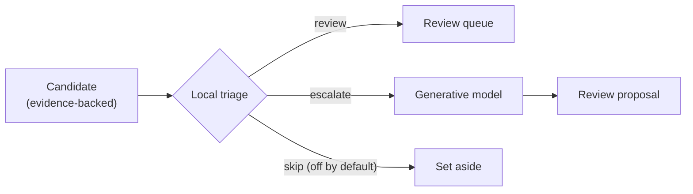

# Cost-aware classification and triage (development preview)

!!! warning "Experimental"
    The local classifier is experimental and not yet calibrated, so it is used
    conservatively: by default it never sets a candidate aside on its own.

Running a generative model on every candidate is slow and costly. Before doing
so, Amass can run an inexpensive, local classification step that decides how much
attention each candidate deserves — so model calls are spent only where they
help.

Each candidate is routed one of three ways:

- **review** — recorded for your triage, with no model call.
- **escalate** — sent to the generative model for analysis.
- **skip** — set aside locally. This is conservative: it applies only under an
  explicit, calibrated policy, it is **off by default**, and it is never an
  ownership conclusion.

## Conservative by default

Because the local classifier is not calibrated, Amass does not let it suppress
analysis on its own. By default, every candidate with enough evidence is still
escalated; automatic skipping is reserved for a future, independently validated
policy.

## It never decides ownership

Classification only routes effort — it does not conclude that two organizations
are related. A shared CDN or a similar name is not evidence of a relationship;
conclusions come from the evidence and from your review.

## Audit

Every decision is recorded, and generative proposals are checked against their
evidence and the Open Asset Model before they appear for review. Nothing here
changes the database on its own — see [review](../usage/review.md).
