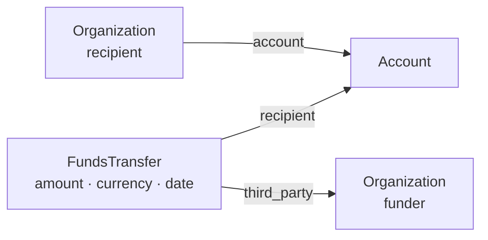

# Funding and procurement data (development preview)

!!! warning "Unreleased feature"
    This page describes the `feature/ai-investigation-inference` branches.
    These capabilities are not yet published or production-ready.

Amass collects the public funding an organization has received — venture
rounds, government grants, contracts and procurement awards — and stores each
as a `FundsTransfer` in the Open Asset Model. The [`funding`](../usage/lenses.md#funding)
and [`group-funding`](../usage/lenses.md#group-funding) lenses surface it. A
funder named on a transfer is a strong signal of an organization's backers,
partners, suppliers and grantees.

## How a transfer is modelled

Each award or round is one `FundsTransfer` (its amount, currency and date). It
is linked:

- `FundsTransfer --recipient--> Account` — a checking `Account` the recipient
  organization controls, so the organization's funding is reachable from the
  organization.
- `FundsTransfer --third_party--> Organization` — the funder (investor, agency
  or contracting body).

A record with no monetary value is skipped rather than stored.

## Sources

All of the collectors below are **keyless and on by default** — no API key or
setup. Each applies only where it has coverage (a US source matches nothing for
a non-US organization, and stores nothing), requests are rate-limited, and
collection follows the normal TTL cadence. Any source can be turned off per
session through the `transformations` section of the configuration (see
[Transformations](../configuration/transformations.md)); each is its own named
source so they can be excluded individually.

| Source | Region | What it adds |
| :--- | :--- | :--- |
| USAspending | US | Federal contracts and assistance |
| NSF, NIH-RePORTER, SBIR | US | Federal research grants |
| ProPublica | US | Nonprofit 990 data (EIN, address, contributions) |
| SEC-EDGAR | US | CIK, Form D raises, business phone and address |
| TED | EU | European public procurement |
| OCDS publishers | International | Public procurement (see below) |

## Open Contracting (OCDS)

Amass reads public procurement published in the Open Contracting Data Standard
(OCDS). Publishers differ in how their data is reached:

- **Supplier-search publishers** offer an API that can be queried by supplier
  name; Amass queries it for each organization.
- **Bulk publishers** offer only a full export. These are fetched **on-demand**:
  a country's export is downloaded (once per day, then matched by supplier) only
  when an organization from that country is enumerated, so a run that touches no
  organizations from a country never downloads its data.

Currently enabled publishers include Mexico (Nuevo León), the United Kingdom
(Find a Tender), Rwanda, the Dominican Republic, Honduras and Paraguay.

## Identifiers and correlation

Alongside funding, Amass collects government and registry identifiers (LEI,
D-U-N-S, EIN, SEC CIK, and others). A shared registry identifier is a strong
indication that two stored organizations are the same company, and shared
funders suggest two organizations are affiliated. These surface as
[review](../usage/review.md) proposals for you to confirm.
