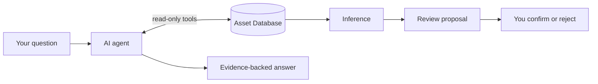

# AI-powered investigations (development preview)

!!! warning "Unreleased feature"
    This page describes the `feature/ai-investigation-inference` branches.
    These capabilities are not yet published or production-ready.

OWASP Amass is adding optional, model-independent reasoning over the
[Open Asset Model](../open_asset_model/index.md). You can ask plain-language
questions about what has been collected and get **evidence-backed** answers, and
Amass can **propose** correlations — such as which organizations are really the
same company — for you to review. Collected facts and AI inferences are kept
separate, and nothing an AI suggests changes the database until you accept it.



## Two workflows

1. **Investigations** — read-only tools inspect assets, relationships and
   evidence, and a model explains the findings. Nothing is changed.
2. **Inference proposals** — Amass proposes correlations backed by evidence.
   They stay in a [review](../usage/review.md) journal and never change the
   database until you accept them.

## Asking a question

```console
amass ai -config /path/to/config.yaml \
  -provider compatible \
  -model YOUR_MODEL \
  -endpoint https://MODEL_HOST/v1/chat/completions \
  -question "What evidence connects these assets?" ask
```

Amass can also run inference over an evidence-backed candidate file with
`amass ai infer`; see [classification and triage](classification.md).

## Using it through an assistant (MCP)

Amass exposes a restricted, read-only set of graph tools through an MCP server,
so an AI assistant can explore the Asset Database on your behalf:

- `get_asset` — retrieve an entity by its database ID.
- `find_assets` — find a bounded number of assets by type.
- `walk_relations` — traverse a bounded neighborhood of the graph.
- `get_evidence` — read the evidence and source behind a fact.
- `render_graph` — draw a bounded result as a diagram.

## Model independence

Amass is not tied to one model. It ships OpenAI-compatible and Anthropic
adapters, and approved local endpoints can be used instead — so inexpensive,
CPU-based triage can run without a hosted model call.

## What stays trustworthy

- Collected facts stay separate from AI inferences.
- Evidence is verified against the database before it is used.
- The agent has no raw SQL, shell, or arbitrary network access.
- Graph queries are bounded (depth, row count, output size, number of calls).
- Content from the internet is treated as data, never as instructions.
- A matching name alone never establishes that two organizations are the same.

See [classification and triage](classification.md).
