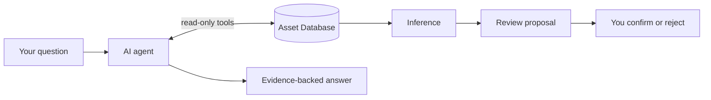

# AI-powered investigations (development preview)

!!! warning "Unreleased feature"
    This page describes the `feature/ai-investigation-inference` branches.
    These capabilities are not yet published or production-ready.

OWASP Amass is adding optional, model-independent reasoning over the
[Open Asset Model](../open_asset_model/index.md). You can ask plain-language
questions about what has been collected and get **evidence-backed** answers, and
Amass can **propose** correlations — such as which organizations are really the
same company — for you to review. Collected facts and AI inferences are kept
separate, and nothing an AI suggests changes the database until you accept it.



## Two workflows

1. **Investigations** — read-only tools inspect assets, relationships and
   evidence, and a model explains the findings. Nothing is changed.
2. **Inference proposals** — Amass proposes correlations backed by evidence.
   They stay in a [review](../usage/review.md) journal and never change the
   database until you accept them.

## Asking a question

```console
amass ai -config /path/to/config.yaml \
  -provider compatible \
  -model YOUR_MODEL \
  -endpoint https://MODEL_HOST/v1/chat/completions \
  -question "What evidence connects these assets?" ask
```

Amass can also run inference over an evidence-backed candidate file with
`amass ai infer`; see [classification and triage](classification.md).

## Using it through an assistant (MCP)

Amass exposes a restricted, read-only set of graph tools through an MCP server,
so an AI assistant can explore the Asset Database on your behalf:

- `get_asset` — retrieve an entity by its database ID.
- `find_assets` — find a bounded number of assets by type.
- `walk_relations` — traverse a bounded neighborhood of the graph.
- `get_evidence` — read the evidence and source behind a fact.
- `render_graph` — draw a bounded result as a diagram.

In operator mode, an assistant can also add what it found by other means
with `contribute`: up to 50 assets, relationships and properties, each
checked against the Open Asset Model and carrying its evidence. You approve
the exact list first, and can undo it later from
[review](../usage/review.md).

Operator mode also plans and starts enumerations, each approved by you. When
another engine on the same database is already enumerating that scope,
`start_enumeration` joins its enumeration instead of starting another, and
`enumeration_status` shows the shared job and the whole job's progress (see
[several engines on one database](../engine/index.md#several-engines-on-one-database)).
`data_sources` shows which data sources have keys and where each comes from,
and `data_source_key_link` gives you a one-time local page to enter a key.

## Configuration assistant

The assistant can also help with the Amass configuration itself. Because
the MCP server runs no model of its own — the connected assistant is the
model — the server exposes the schema and the checks, and the assistant
does the drafting:

- `describe_config`: the configuration schema (every section and field
  with its type, default, description and an example), the current
  settings with data source credentials masked, and a commented template
  to start a new file from.
- `validate_config`: check a complete draft with the real Amass loader
  and show a credential-masked diff, without changing anything.
- `apply_config`: write a validated draft to the configuration file,
  after the user approves it and sees the exact masked diff. This is an
  operator-mode tool; read-only connections can describe and validate but
  not apply.

A terminal user gets the same help from the locally configured model:

```console
amass ai -config /path/to/config.yaml \
  -provider compatible -model YOUR_MODEL \
  -endpoint https://MODEL_HOST/v1/chat/completions \
  -question "Set up a passive enumeration of example.com" config
```

It prints the proposed configuration and a masked diff, and writes it
only on approval — at an interactive prompt, or ahead of time with
`-approve-config`.

Data source credentials never pass through the model: they are masked in
what `describe_config` returns and in every diff, and a draft that sets
any is refused. Keys are entered by the operator through a one-time local
link (`data_source_key_link`) or `amass secrets set`, never written by the
assistant. With a secrets key, they're stored encrypted in the Asset
Database, where every engine on it uses them (see
[data sources](../configuration/data_sources.md#credentials-outside-the-file)).

## Learning from review

Proposals go to a review journal, where a person approves or rejects them.
Those decisions train small, local models that replace hand-set signal
weights with weights learned from your choices, one for each question:

- `ownership`: whether an organization owns the asset an ownership proposal
  names;
- `horizontal`: whether a related domain tied to an organization by
  supporting evidence only belongs in its scope. It also learns from the
  domains the main model admitted, or advised rejecting, at 90% confidence
  or more, and is judged only on your decisions;
- `name_kind`: whether a name in a person's field is a person's or an
  organization's, from your `-as person` and `-as organization` decisions,
  and from the main model's answers at 90% confidence or more.

With a PostgreSQL or SQLite Asset Database, the review journal is kept in
the database, so the decisions made by every engine and person on it are
learned from together.

Besides the main model's confident answers named above, only people's
decisions are learned from, and your decision replaces the model's. A
classifier's own decisions and the re-checks never are, so a model never
learns from itself. A kind is
trained once it has at least 20 of your decisions.

```bash
# Train (or retrain) every kind with enough decisions, or one with -kind.
amass ai -config /path/to/config.yaml train
amass ai -config /path/to/config.yaml train -kind ownership

# Report, for each kind, whether a model is trained, what it decides with,
# and how many of your decisions are on hand.
amass ai -config /path/to/config.yaml status
```

A trained model is kept where the journal is: in the Asset Database when the
journal is kept there, so every engine on the database, on any machine, uses the
newest model, and otherwise as a file in the directory of the configured journal
path (`options.ai.journal`). Enumerations load the newest model when they start,
and running engines pick up a new horizontal model within ten minutes. The
ownership model is used everywhere ownership is decided: the engine's automatic
attribution from the next enumeration, the `amass ai` ownership-gap answers, and
the MCP ownership-gap tool. The model only ever ranks and decides candidates the
rules already found attributable; weak and ambiguous candidates stay with the
rules, and until a model is trained the static signal weights decide. The
threshold for an automatic write is set above the highest score any rejected
proposal received, so the model writes nothing a reviewer turned down. When the
search behind a pass is cut short (its time ran out, or a limit stopped it),
nothing is written automatically: the part not read could rule a candidate out,
so every proposal waits for review.

## Scope decisions during an enumeration

An enumeration widens its scope when evidence ties another domain to the
organization you asked about. Strong evidence, such as the same registrant
organization or a name server inside the organization's own domains, decides
on its own. A domain tied only by supporting evidence, such as the same
favicon or the same page served from both, is a judgment call.

When attribution is `auto` (the default) and a main model is configured, the
main model makes that call. It's shown each piece of evidence, what it means
and when it can mislead, and decides on its own whether to admit the domain.
It admits a domain only when it's at least 80% confident. An admitted
domain:

- is investigated as part of the organization's scope from then on;
- is recorded in the review journal as an automatic decision, which
  `watch_decisions` and the end-of-run summary report;
- can be undone: `amass review applied` lists automatic decisions, and
  `amass review retract -proposal <id> -reviewer <name>` retracts one. Later
  enumerations then never widen their scope to that domain again; what the
  run already collected stays in the database.

A domain the model doesn't admit waits in the review journal for you. With
attribution set to `journal` or `off`, or with no main model, every such
domain waits for review. `amass review proposals` lists them under "Scope
expansions". `amass review approve -proposal hdom-… -reviewer <name>` admits
the domain the next time an enumeration finds it, and `amass review reject`
keeps every later enumeration away from it.

This uses the main model (`options.ai`, or the `AMASS_LLM_*` settings), never
the document model, so each can be a model suited to its task. When several
engines share an enumeration, they share these decisions: the model is asked
about a domain once, by one engine, and the others take its answer.

If the main model fails three requests in a row during a run (it is
unreachable, refuses or times out), it isn't asked again in that run, and the
log says so once. Everything it would have decided is left to the rules, a
trained classifier and review, as when no main model is set, so the run isn't
held open waiting out a timeout for each decision.

## Person or organization?

Registries and documents often put an organization's name where a person's
belongs: a company as a domain's registrant contact, or a university as a
document's author. Most names settle on their words and on what the database
already holds. A name that doesn't is kept on the record that gave it and
proposed for review, and, with a main model configured, the model is asked
about it during the run. It's shown the name, where it was found and what is
known around it, and must cite the evidence its answer rests on.

- With attribution `auto`, an answer at 90% confidence or more is applied:
  the name becomes a person or an organization, recorded as an automatic
  decision that `amass review retract` undoes.
- Any other answer, and every answer with attribution `journal`, is kept on
  the proposal as advice, shown in `amass review proposals`, and you decide
  with `amass review approve -as person` or `-as organization`.
- With no main model, or attribution `off`, the names wait for review.
- A name still waiting with no answer, because the model failed or wasn't
  set up when it was found, is asked again when a later run finds the same
  name on the same record.
- The model is asked once per name in a field. Another file with the same
  author name takes the answer already given, or your decision on that name,
  without asking again.

A small local classifier, trained with `amass ai train`, answers first, and
the main model is asked only about the names it isn't sure of. It learns
from your decisions and from the main model's confident answers (90% or
more, citing their evidence, and not retracted), but it is judged only on
your decisions. Some of them are held out of training to check it, so it
needs a few of each kind from you before it is trained. Where you decided a
name, your decision replaces the model's.

Its answers are advice, shown with the proposal, unless you set
`options.ai.classifier_applies: true`. Then a confident answer is applied
like the model's, and about one name in ten that it is sure of is still
asked of the main model to check it. When the two disagree, nothing is
applied and the name waits for you, with both answers. Without a main model,
a trained classifier still gives its advice. It also gives its advice on
each new `amass db org-named` proposal, a person stored under what looks
like an organization's name.

The questions are asked one at a time beside the run, and count as the run's
background work, so `options.background_hold` bounds how long a finished run
keeps asking.

## Model independence

Amass is not tied to one model. It ships OpenAI-compatible and Anthropic
adapters, and approved local endpoints can be used instead — so inexpensive,
CPU-based triage can run without a hosted model call.

## What stays trustworthy

- Collected facts stay separate from AI inferences.
- Evidence is verified against the database before it is used.
- The agent has no raw SQL, shell, or arbitrary network access.
- Graph queries are bounded (depth, row count, output size, number of calls).
- Content from the internet is treated as data, never as instructions.
- A matching name alone never establishes that two organizations are the same.

See [classification and triage](classification.md).
