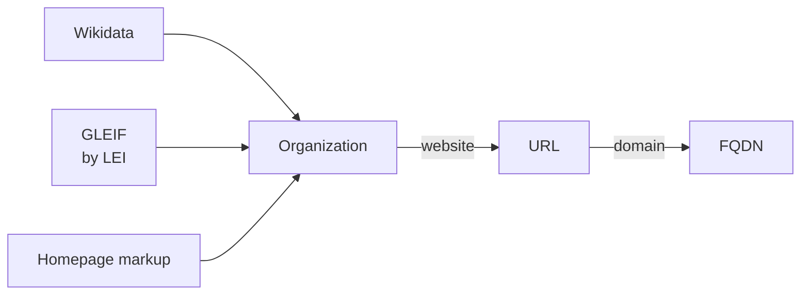

# Organizations: identity and geography (development preview)

!!! warning "Unreleased feature"
    This page describes the `feature/ai-investigation-inference` branches.
    These capabilities are not yet published or production-ready.

Amass builds a picture of the organizations behind the assets it finds. This
page covers how Amass identifies the company behind a domain — even when the
site is hosted in the cloud — and how it works out where an organization is.

## Identifying the company behind a domain

When Amass enumerates a registered domain, it tries to add the company that owns
it as an `Organization` linked to that domain. For a company that runs its own
network, this comes from registration records (RDAP/WHOIS) and TLS certificates.
When a site is hosted in the cloud, those records name the hosting provider, not
the company, so Amass also looks the company up from the domain itself:

- **Wikidata** — the entity whose official website is the domain, with its name,
  country and Legal Entity Identifier (LEI). Works in any enumeration mode.
- **GLEIF** — the authoritative Legal Entity Identifier record (legal name,
  jurisdiction, registration ID, addresses, related entities), looked up by the
  LEI the other sources supply. Works in any mode.
- **Homepage markup** — the organization a website publishes about itself in its
  schema.org page markup (name, country, identifiers). Because it is
  self-asserted it is used mainly to confirm the other sources, and it requires
  an **active** enumeration (it reads the live homepage).

- **SEC filings** — for a company that files with the US Securities and
  Exchange Commission, the subsidiaries listed in its latest annual report
  (Exhibit 21 of a Form 10-K, or Exhibit 8 of a Form 20-F for a foreign
  company). Each subsidiary is added as an `Organization` with its
  jurisdiction, joined to the company by a `subsidiary` relation, and then
  looked up like any other organization. Works in any mode.

These sources are keyless and on by default, and each can be turned off per
session in the [`transformations`](../configuration/transformations.md)
configuration. Amass keeps a single organization per company and records which
source provided each fact, so you can always see where a detail came from.

## How it appears in the graph

A discovered company is linked to its domain through standard Open Asset Model
relations, so the company is reachable from the domain and vice versa:

So from a domain you can reach the organization that owns it, and from an
organization you can reach the domains it controls — which the
[lenses](../usage/lenses.md) use to describe an organization's footprint.

## Where an organization is

Amass infers an organization's country from the evidence it has collected,
preferring the most reliable signal available: its legal jurisdiction (from
GLEIF or a registration), then a registration or contact address, then the
country of a registrant phone number. The [`geography`](../usage/lenses.md#geography)
lens reports this inferred country for an organization, alongside the countries
of its stored addresses and of the networks hosting its names.

Knowing an organization's country also lets Amass apply country-specific sources
correctly — for example fetching a country's public-procurement data only when
an organization from that country is seen (see
[Funding and procurement](funding.md)).

## Related pages

- [Funding and procurement data](funding.md)
- [Lenses](../usage/lenses.md) — `geography`, `funding`, `family` and the rest.
