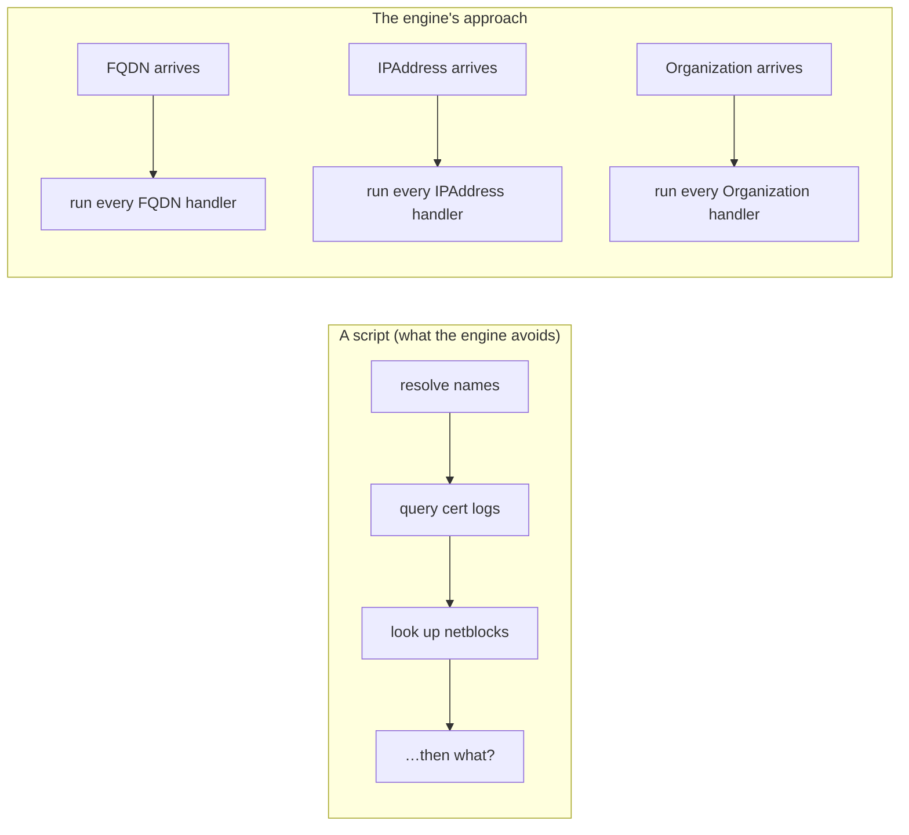
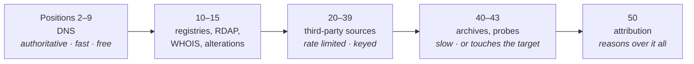
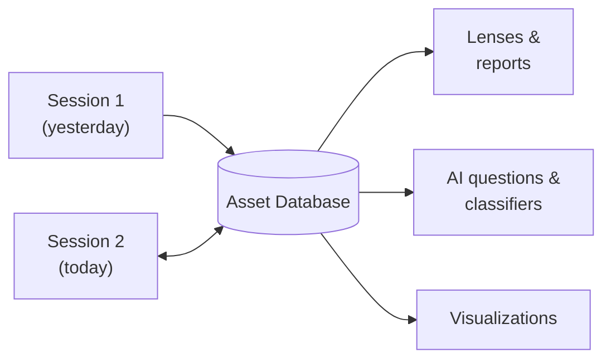
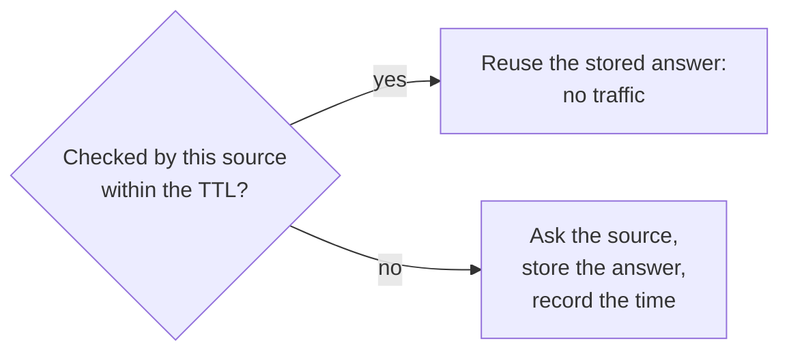
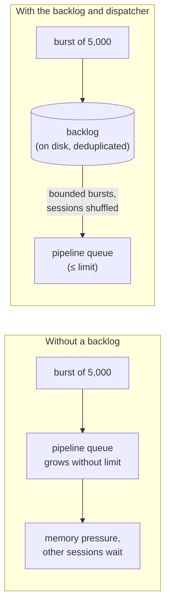
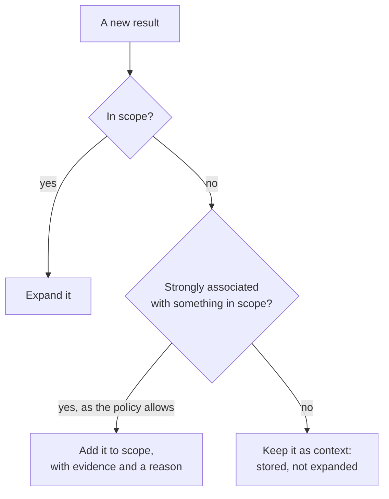
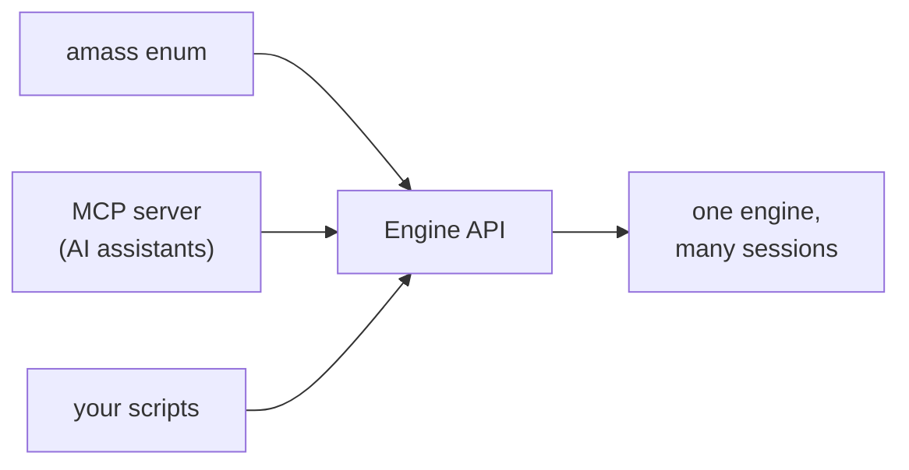
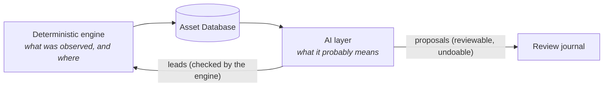

# :material-lightbulb-on-outline: The Logic Behind the Engine's Design

[How the Engine Works](index.md) describes *what* the Amass collection engine
does. This article is about *why*. Every design choice answers a problem that
attack surface discovery keeps running into. Knowing the problem makes the
engine easier to use well, easier to extend, and easier to reason about when its
results surprise you.

---

## The problem the engine has to solve

External attack surface discovery has an awkward shape:

- **You never know the full list of questions in advance.** You start with one
  domain. Its certificates name hosts you didn't know about, and those hosts
  resolve to addresses in a netblock. The netblock is registered to an
  organization, which owns other domains. What you should ask next depends on
  what you just learned.
- **The answers come from many places of very different quality.** DNS is
  authoritative and instant. A certificate log is authoritative but noisy. A
  paid API is fast but rate limited, and a web archive is slow. A scraped search
  page is fragile. And a probe of the target's own hosts must be paced and
  authorized.
- **The work is explosive.** One wildcard certificate or one netblock can turn
  into thousands of new things to check.
- **Most of it has been asked before.** You enumerate the same organizations
  again and again, so most answers have barely changed since last week.
- **Not everything you find is yours.** The graph runs into cloud providers,
  CDNs, registrars and vendors. Following every edge would enumerate the
  Internet.

The engine's design is a set of answers to those five pressures.

---

## 1. Make the data model the unit of work

**Decision:** every discovery is an [Open Asset
Model](../open_asset_model/index.md) asset, and every asset becomes an event,
processed by the pipeline for its asset type.

**Why:** if you can't know the questions in advance, you can't write the
enumeration as a fixed script. What you *can* know in advance is the **types**
of things you'll meet (FQDNs, IP addresses, certificates, organizations) and,
for each type, what's worth asking about it. So the engine is organized around
the data model rather than around a procedure:

The order of work emerges from the data. A certificate that arrives late still
gets every certificate handler, and an organization found on the fourth hop is
treated exactly like one you seeded.

**What it buys you:** adding a data source means adding a handler for an asset
type, with no orchestration to rewrite. The [~100
handlers](index.md#plugins-and-handlers) across the plugins don't know about
each other; they meet only in the data.

---

## 2. Order the work: cheap and certain first

**Decision:** each asset type's pipeline is a sequence of **positions** (1–50).
Cheap, authoritative checks run early, slow or rate-limited sources later, and
wrap-up work last.

**Why:** if every handler ran at once, they'd duplicate each other and waste the
expensive sources. Ordering lets later handlers build on earlier ones. On an
FQDN, DNS runs first (CNAME at position 2, addresses at 3), so by the time a
paid API or a web archive sees the name, the engine already knows whether it
exists, what it points to, and whether it's an alias. The attribution plugin
sits at the very end, so it reasons over everything the other handlers
collected.

**Why not a strict queue, one handler at a time?** Handlers at the same position
run side by side, and each stage works on several events at once (up to its
handlers' instance limits). A slow archive slows only its own stage, while DNS
keeps working on newer events. You get the benefits of order without paying for
it in throughput.

---

## 3. Treat the graph as the system of record, not as memory

**Decision:** handlers store every asset, relation and property in the [Asset
Database](../asset_db/index.md) the moment they find it, together with its
source and a confidence. The engine keeps very little state of its own.

**Why:** several reasons point the same way.

- **Results survive.** A crash, a timeout or a cancelled run loses only the work
  in flight, not what was found.
- **Sessions can help each other.** Two enumerations of related targets share
  one database, so the second starts with everything the first learned.
- **Every fact is attributable.** Because each asset carries where it came from
  and how sure the source was, any answer can be traced back to its evidence.
  The lenses and the AI layer rely on this.
- **Reading is separated from collecting.** [Lenses](../usage/lenses.md),
  reports, visualizations and AI questions run against the database, not the
  engine, so you can study results while the engine is still collecting, or long
  after it stopped.

---

## 4. Don't ask twice: freshness through TTLs

**Decision:** every transformation has a **TTL**. When a source checks an asset,
the engine records when. Inside the TTL, handlers reuse the stored answer
instead of querying again.

**Why:** most of what you enumerate this week you enumerated last week too.
Re-asking every source every time would be slow, would burn API quotas, and
would be rude to the data providers and the target. TTLs give you a dial per
transformation. DNS answers might be refreshed daily, RDAP for an autonomous
system monthly, and a product's release data weekly. You get fresh data where
things change quickly, and cheap reuse where they don't.

**The trade-off:** a long TTL can hide a change. If you need everything
re-verified, for example after an incident, lower the TTLs for that run in the
[transformations](../configuration/transformations.md) configuration.

---

## 5. Absorb the explosion: a durable backlog and a fair dispatcher

**Decision:** discovered assets don't go straight into pipelines. They go into
each session's **backlog**, a small durable queue with leases, and a
**dispatcher** feeds the pipelines from it in small, bounded bursts.

**Why:** discovery is bursty, and a pipeline that accepted everything
immediately would grow without limit. The backlog solves three problems at once:

| Problem | How the backlog answers it |
|:--|:--|
| **Duplicates.** The same name reported by 15 sources. | The backlog remembers every asset the session has seen; a repeat is dropped before any work is done. |
| **Bursts.** 5,000 addresses from one netblock. | They wait on disk, not in memory; pipelines are fed only as they drain. |
| **Lost work.** An event fails to enter a pipeline. | Items are *leased*, not removed; a failed hand-off releases the lease and the item is queued again. |

And because one engine can run many sessions, the dispatcher visits sessions in
**random order**, taking only a small **burst** from each, so a huge enumeration
can't starve a small one. Busy, cheap asset types (FQDNs and addresses) get
bigger queues and bursts; rarer, heavier types get smaller ones.

---

## 6. Know when to stop: scope with confidence and explanations

**Decision:** every session has a **scope** (domains, addresses, netblocks,
ASNs, organizations, street addresses), and only in-scope results are expanded.
Out-of-scope results are still stored. Scope can grow by **association**, with
recorded evidence and a rationale, as far as the **expansion policy** allows.

**Why:** the graph of the Internet is connected. Without a boundary, following
"who hosts this" and "who else uses that name server" would eventually enumerate
a cloud provider, then its customers, then everyone. But a fixed list of domains
is too narrow, because organizations own things you didn't know to list. Hence
the three tiers:

**Why keep out-of-scope results at all?** Because context is often the answer.
"Which CDN fronts this host?", "who issued this certificate?" and "which vendor
runs this mail server?" are all questions about assets outside your scope that
touch it. Storing them costs little, and expanding them would cost a lot.

**Why record a rationale?** Because a scope change is a decision, and you should
be able to challenge it. When the engine widens your scope, the log says what it
added and why.

---

## 7. Put the user in charge of the flow: transformations as configuration

**Decision:** the paths the engine may follow (which asset type may become
which, through which plugin) are listed in `config.yaml`, not hard-coded.

**Why:** different jobs need different engines. A quick passive look shouldn't
run probes. A compliance-sensitive engagement may forbid certain sources. A
research run might want only certificate data. Making transformations
configuration means the same engine serves all of them, and you can read exactly
what a run is allowed to do. A handler runs only when a transformation names it
(or `ALL` includes it and doesn't exclude it).

---

## 8. Run as a service, talk through an API

**Decision:** the engine is a long-running service with a small REST API and a
WebSocket log stream. The `amass enum` command is just one client.

**Why:**

- **Many front ends, one engine.** The command line, the MCP server that AI
  assistants use, a dashboard or your own scripts all start and watch sessions
  the same way.
- **Long work outlives a terminal.** An enumeration can run for hours; the
  client can disconnect and the work continues.
- **Shared resources.** Pipelines, HTTP clients, network budgets and the
  database connection are set up once and shared fairly, instead of per
  invocation.

---

## 9. Fail small: isolation everywhere

**Decision:** a handler's panic becomes that event's error, not a crash. Each
session has its own context, backlog and log. Network use is divided among
sessions and paced.

**Why:** with about 100 handlers calling the open Internet, something is always
failing. A data source changes its format, a scraped page redesigns, a host
sends garbage. The engine assumes failure is normal:

- **One bad handler** fails one event, logged with its stack, and every other
  event and session carries on.
- **One bad session** can be cancelled without touching the others.
- **One busy session** gets its share of network connections, not all of them,
  and active probes against a target are paced.

---

## 10. Keep the engine deterministic, and layer intelligence on top

**Decision:** the collection engine uses **no language model**. AI features sit
beside it (the document model companion, the MCP server) and at the end of it
(the attribution plugin's classifiers). They interact with the engine only
through the same paths as everything else: assets in, assets and proposals out.

**Why:** collection has to be reproducible and explainable. You should be able
to say exactly why a host is in your inventory: *DNS said so*, or *this
certificate named it*. A model's judgement is valuable for connecting dots and
answering questions, but it shouldn't decide silently what gets collected. So:

- A **document lead** from the AI is handed to the engine as an ordinary asset.
  The engine checks it like anything else, and it joins the scope only if the
  evidence ties it to your target. Unconfirmed leads expire when the run ends.
- **Classifiers** propose ownership and merges. Strong evidence can apply them
  automatically, every change goes into a review journal, and any change can be
  undone.
- **Questions** go to the Asset Database, not to the engine.

---

## The trade-offs, honestly

No design is free. These are the costs of the choices above, and what to do
about them.

| Choice | Cost | What to do |
|:--|:--|:--|
| Ordered pipelines | An event waits for earlier stages before later sources see it. | Nothing, usually. Stages work on many events at once, so throughput stays high. |
| TTL reuse | A change inside the TTL isn't noticed. | Lower the TTL for the transformations you need fresh. |
| Out-of-scope context is stored | The database holds more than your targets. | Lenses walk from your targets, so context shows up only where it touches them. |
| Scope association | The scope can grow beyond what you listed. | Read the logged rationale, or use the strict expansion policy. |
| Static dispatcher limits | Burst sizes aren't tuned per deployment. | They favor fairness. Large single-tenant runs still finish; they just don't monopolize the engine. |
| Engine as a service | One more process to run. | The Docker Compose setup runs the engine, the database and the clients together. |

---

## In one paragraph

The engine treats the Open Asset Model as its program. Each asset it finds is
stored at once, and then run through the handlers for its type: cheap and
authoritative first, slow and costly later, reasoning last. A durable,
deduplicating backlog absorbs bursts, and a fair dispatcher keeps many
enumerations moving on one engine. TTLs stop it from asking twice. Scope, with
explained expansion, stops it from enumerating the Internet. Configuration
decides which paths it may take. And because it stays deterministic, with
intelligence layered on top through the same assets-in, assets-out paths, every
answer it gives can be traced back to something that was actually observed.

**See also:** [How the Engine Works](index.md) ·
[Transformations](../configuration/transformations.md) ·
[Asset Database](../asset_db/index.md) · [AI (Experimental)](../ai/index.md)
