# :material-engine-outline: How the Engine Works

The Amass **collection engine** is the part of Amass that goes out and finds
things. You give it a starting point, such as a domain, a netblock or an
organization. It works outward from there, asking DNS, registries, certificate
logs, web archives and dozens of other data sources what they know. Everything
it learns goes into the [Asset Database](../asset_db/index.md) as a graph of
[Open Asset Model](../open_asset_model/index.md) assets and relations.

This page walks through the engine one piece at a time, from the big picture
down to a single event moving through a pipeline. If you want to know *why* it's
built this way, read [The Logic Behind the Engine's Design](design.md) next.

!!! tip "The one idea to keep in mind"
    **Every discovery is an asset, and every asset is a unit of work.** When the
    engine finds a new name, address, certificate or organization, it stores it
    and then asks: *"what else can this lead to?"* That loop, repeated thousands
    of times and kept inside your scope, is an enumeration.

---

## :material-map-outline: The big picture

The engine runs as a **service**. It doesn't print results itself: clients talk
to it over an HTTP API, and it writes everything it finds to the Asset Database.
Several clients, and several enumerations, can share one engine at the same
time.

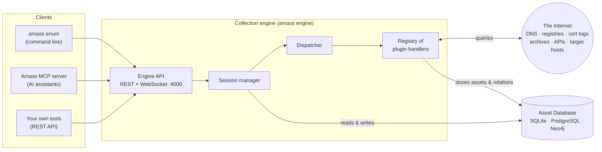

| Piece | What it does |
|:--|:--|
| **Engine API** | Accepts new sessions and seed assets, reports progress, and streams each session's log over a WebSocket. |
| **Session manager** | Creates, tracks and ends **sessions**. A session is one enumeration with its own configuration and scope. |
| **Dispatcher** | Decides which discovered asset gets worked on next, sharing the engine fairly between sessions. |
| **Registry** | Knows every **handler** each plugin offers, and builds the pipeline of handlers for each asset type. |
| **Plugins** | The collectors: DNS, RDAP and WHOIS, certificate logs, web archives, service probes, documents, roughly 35 third-party data sources, and more. |
| **Asset Database** | The system of record. Every asset, relation and property the engine finds is stored here as soon as it's found. |

---

## :material-account-switch-outline: Sessions: one enumeration each

When you run `amass enum -d example.com`, the command-line client asks the
engine for a **session**, sends the seed assets (here, the domain), then watches
the session's log and progress until the work runs out.

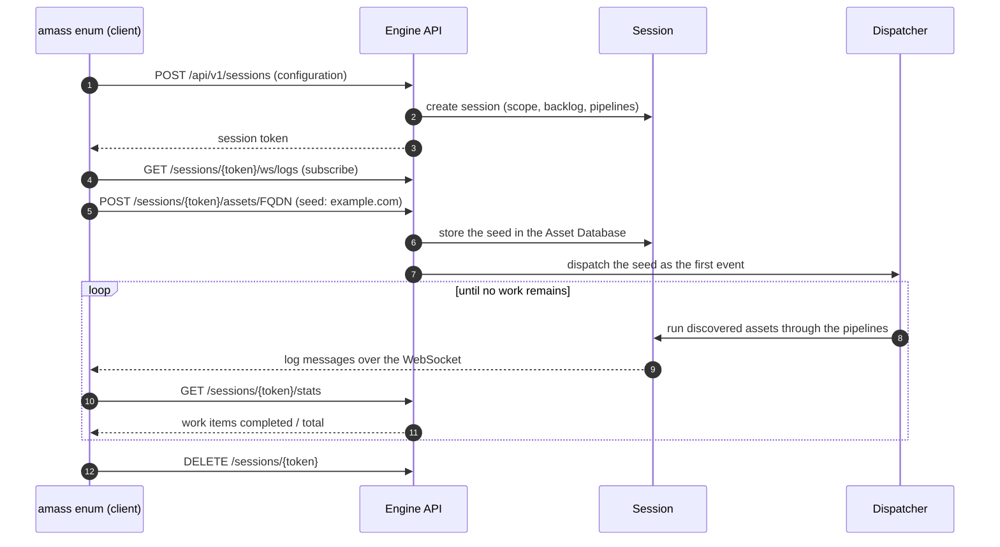

Each session carries everything it needs to work on its own:

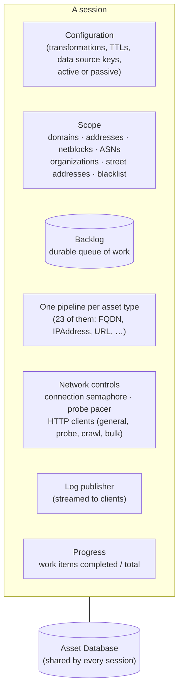

!!! info "Sessions share the database, not their work"
    Two sessions enumerating related targets write into the **same** Asset
    Database, so one can reuse what the other already learned (see
    [freshness](#freshness-ttls-reuse-what-is-already-known)). Each still has
    its **own** scope, backlog and pipelines, so they never step on each other's
    work queue.

---

## :material-transit-connection-variant: The discovery loop

This is the heart of the engine. Each asset that enters a session becomes an
**event**. The event runs through the pipeline for its asset type, and the
handlers in that pipeline turn it into new assets. Those are stored, and each
new asset becomes an event of its own.

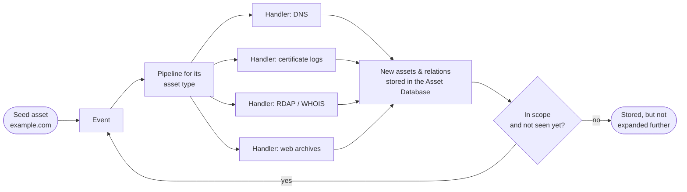

Following one real thread shows how quickly this grows:

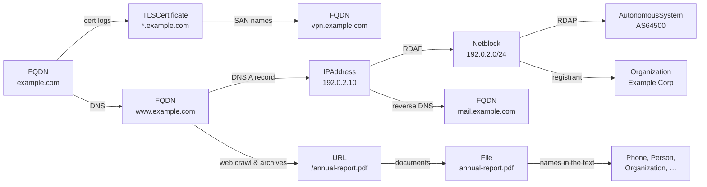

Every arrow is a **transformation**: one asset type becoming another through
some source. [Transformations](../configuration/transformations.md) in your
configuration decide which of these arrows the engine may follow, and how often.

---

## :material-pipe: Pipelines: ordered stages of handlers

The engine keeps **one pipeline per asset type**. A pipeline is a series of
stages, and each stage holds the handlers registered at that **position**, from
1 (first) to 50 (last). Every event of that type passes through every stage, in
order.

Here's the `FQDN` pipeline, simplified. Cheap, authoritative work comes first;
slower or paid third-party sources come later; probes and wrap-up come last:

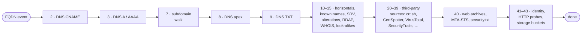

Things to know about stages:

- **Order matters, on purpose.** A later handler can rely on an earlier one's
  work. For example, the DNS A/AAAA handler (position 3) skips names the CNAME
  handler (position 2) already found to be aliases.
- **Handlers that share a position run side by side.** The event moves on when
  all of them have finished. A handler can claim a position for itself alone
  (*exclusive*).
- **Each stage handles several events at once**, up to the fewest instances any
  of its handlers allows. So a slow data source limits only its own stage, not
  the whole engine.
- **A bad handler can't crash the engine.** If a handler panics, that event gets
  an error in the session log and everything else carries on.

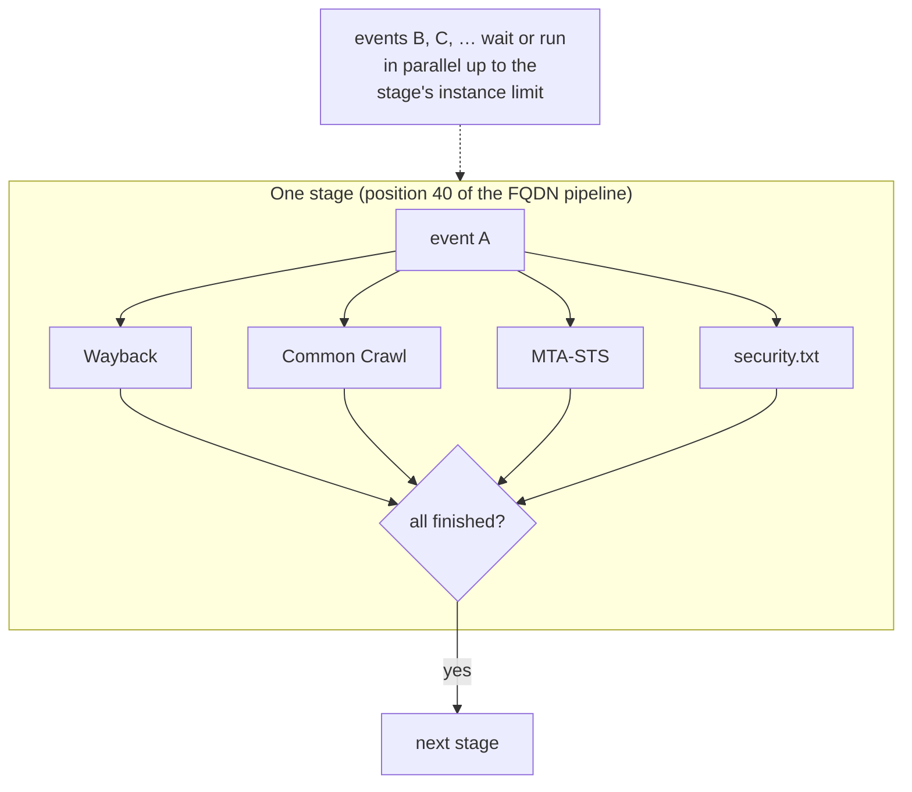

---

## :material-tray-full: The backlog and the dispatcher

Discovery is bursty. One certificate can name 500 hosts, and one netblock sweep
can return thousands of addresses. If every new asset went straight into a
pipeline, memory would balloon and one busy session would starve the others. So
new assets go into a **backlog** first, and the **dispatcher** feeds the
pipelines from it at a sustainable pace.

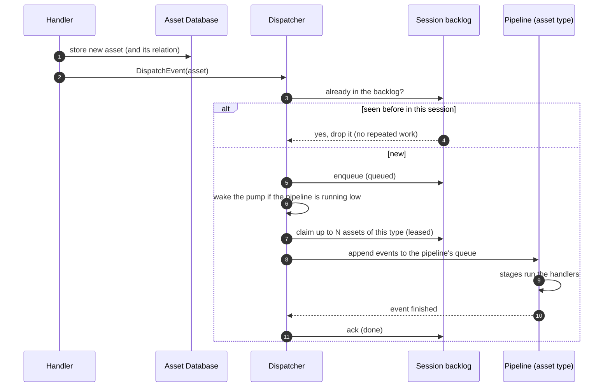

With a PostgreSQL or SQLite Asset Database, the backlog is a work queue in that
database, named by the session; otherwise it is a small SQLite database in the
session's temporary directory. Each item is **queued**, **leased** while a
pipeline works on it, then **done**. In the database, a lease lasts two minutes
and the engine renews it while the session runs, so the items of an engine that
stops return to the queue. If an event can't enter a pipeline, its lease is
**released** and the item is queued again. Because the backlog remembers
everything it has ever seen in the session, the same asset is never worked twice
in one enumeration, however many sources report it.

### Fair sharing between sessions

The dispatcher's **pump** runs whenever a pipeline drops to its low-water mark,
and every 10 seconds regardless. Each time, it visits the sessions in **random
order**. From each one it claims a small burst, never letting a pipeline's queue
exceed its limit:

| Asset types | Pipeline queue limit | Wake-up (low water) | Burst per session per pump |
|:--|:--:|:--:|:--:|
| `FQDN`, `IPAddress` | 200 | 100 | 10 |
| `Service`, `TLSCertificate`, `URL` | 100 | 25 | 5 |
| Everything else | 20 | 5 | 1 |

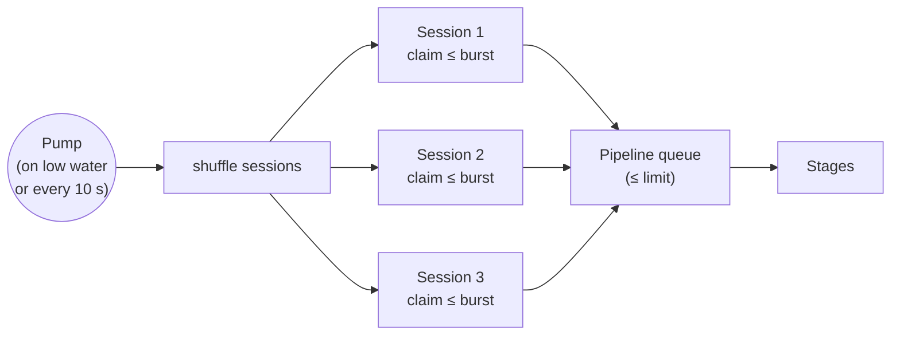

A huge enumeration and a small one can share an engine: the small one keeps
getting its turn.

---

## :material-filter-check-outline: What runs: transformations, freshness, scope

Before a handler touches an event, three questions decide whether it runs, and
whether it contacts anything on the Internet.

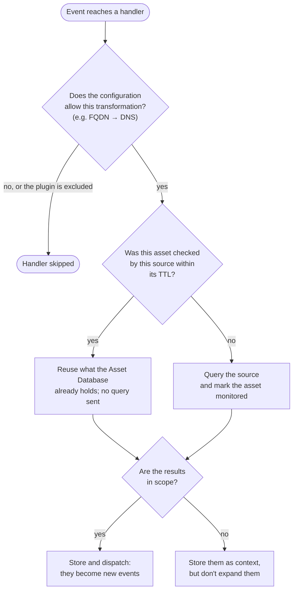

### Transformations: which arrows the engine may follow

The `transformations` section of `config.yaml` lists which asset types may
become which, through which plugin or source, such as `FQDN->DNS`,
`IPAddress->RDAP` or `Product->ALL`. A `FROM->ALL` entry can exclude specific
plugins. A handler runs only when a transformation allows it. See
[Transformations](../configuration/transformations.md).

### Freshness: TTLs reuse what is already known

Every transformation has a **TTL** in minutes. When a source checks an asset,
the engine records when (a `last_monitored` property). If the same asset comes
up again within the TTL, in this enumeration or a later one, the handler reads
the earlier answer from the Asset Database instead of asking again. That's why a
second enumeration of the same target is much faster, and gentler on the data
sources.

### Scope: what is worth expanding

The scope holds the **domains, IP addresses, netblocks, autonomous systems,
organizations and street addresses** you asked about, plus a blacklist. Every
result is checked against it:

- **In scope** results are dispatched and expanded further.
- **Out-of-scope** results are still stored, because they're useful context (who
  hosts this name, who issued that certificate), but they don't grow the
  enumeration.
- **Association** can widen the scope. When a new asset is tied to something
  already in scope strongly enough (for example, a domain registered to your
  organization), the engine can add it, recording the evidence and a
  plain-language rationale. The expansion policy decides how far: each
  transformation's `confidence` is the evidence it needs (above 100, nothing is
  admitted), and its `reach` how far from the scope its work goes. See
  [transformations](../configuration/transformations.md).

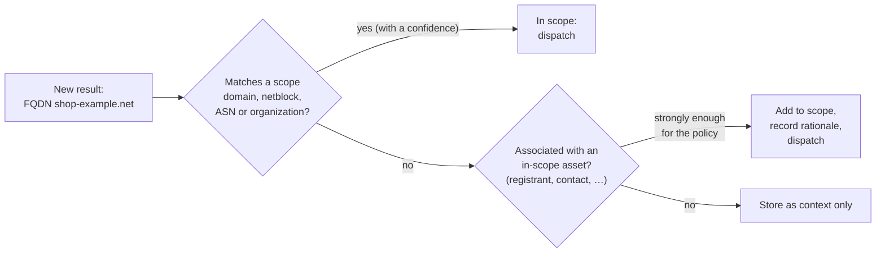

---

## :material-speedometer: Being a good neighbor on the network

An enumeration can send a lot of traffic, to data sources and in active mode to
the target's own hosts. The engine paces itself:

- **A connection semaphore per session.** The engine's network connection budget
  is divided among the running sessions, so starting a second enumeration
  doesn't double the load.
- **A limit per DNS resolver.** The engine sends at most 15 queries per second
  to any one resolver, however many enumerations use it. Change the limit with
  the engine's `-resolver-qps` flag or the `AMASS_RESOLVER_QPS` environment
  variable (`0` removes it). An enumeration can name its own resolvers (`-r`,
  `-tr`, or `resolvers` and `trusted_resolvers` in the configuration file); the
  limit still applies to each of them.
- **One network interface.** The engine's traffic leaves through the interface
  the system chooses, or the one named by the engine's `-iface` flag or the
  `AMASS_IFACE` environment variable (an interface name, such as `eth0`, or one
  of the host's IP addresses). An enumeration can name its own (`-iface`, or
  `interface` in the configuration file, or the `interface` parameter of the MCP
  `plan_enumeration` tool). An interface named by name sends IPv4 traffic from
  its IPv4 address and IPv6 traffic from its IPv6 address; one named by an IP
  address sends only that IP version. Traffic of an IP version the interface has
  no address for is not sent through another interface.
- **A separate route for active traffic.** Probes, banners, certificates, JARM
  fingerprints and zone transfers, the traffic that reaches the target's own
  hosts, can take their own route: another interface, or a SOCKS5 or HTTP
  CONNECT proxy such as Tor (`-active-route` or `AMASS_ACTIVE_ROUTE` for the
  engine, `-active-route` or `active_route` for an enumeration, for example
  `socks5h://tor:9050`). Each enumeration gets its own Tor circuits. A proxy
  carries TCP only, so active UDP leaves from `-active-udp-route`
  (`AMASS_ACTIVE_UDP_ROUTE`) when it is set and isn't sent otherwise. Active
  traffic never falls back to a direct connection, and a refusal by the proxy or
  a Tor exit isn't taken as evidence about the target.
- **A probe pacer** spaces out active probes (certificate and service probes,
  zone transfers) against the target's hosts.
- **A probe gate** bounds how many active probes are in flight at once from the
  engine's public address, shared by every enumeration it runs: at most 16 to
  one registered domain, 2 to one host name and 4 to one IP address. The
  address limit matters for names behind a CDN, which share a few edge
  addresses and are slowed or cut off when too many connections reach them at
  once. A probe waits for its turn before its own timeout starts, and a name
  is resolved through the enumeration's own DNS resolvers to find its address.
  Set the engine's limits with its `-probe-per-domain`, `-probe-per-name` and
  `-probe-per-address` flags, the `AMASS_PROBE_PER_DOMAIN`,
  `AMASS_PROBE_PER_NAME` and `AMASS_PROBE_PER_ADDRESS` environment variables,
  or `probe_per_domain`, `probe_per_name` and `probe_per_address` under
  `options:` in the configuration file the engine is started with (`-config`),
  in that order of precedence (`0` removes a limit). An enumeration's own
  configuration can set the same options lower for its probes, never higher.
- **Separate HTTP clients** for ordinary API calls, active probes, crawling, and
  slow bulk queries (such as a web archive's index of a whole domain, which can
  take minutes to start answering).
- **Passive versus active.** In passive mode the target's own hosts are
  contacted only by ordinary DNS resolution. Active mode adds certificate and
  banner probes and zone transfers, and is for systems you're authorized to
  test.

The engine's log shows what this traffic met. A data source request that fails,
times out or gets an error status is logged with its host and path (never its
query, which can carry an API key), and every few minutes and when a session
ends, its network use lists each probe plugin's probes by outcome: answered,
refused (a closed port), no answer, timed out after connecting, or failed. A
probe that timed out after connecting is logged on its own, because a burst
the target or the network can't keep up with looks like that. When the engine
logs to a syslog server (`SYSLOG_HOST`), it writes the same records to its
standard error too, so `docker logs` shows them; set `AMASS_LOG_STDERR=false`
to turn that off.

---

## :material-flag-checkered: When is an enumeration finished?

A session tracks **work items**: assets dispatched versus assets fully
processed. It also counts **background work**: jobs that run outside the backlog
but can still produce assets, such as an attribution pass that waits for the
pipelines to drain before comparing organizations.

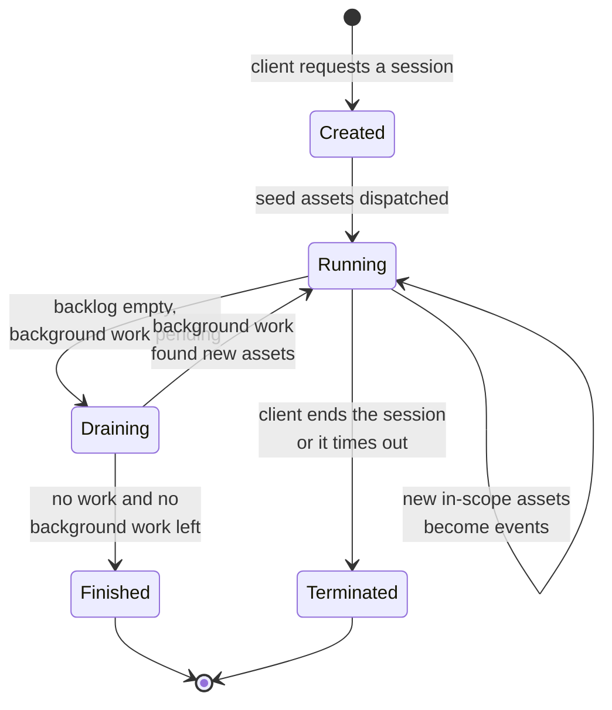

The `amass enum` client ends its session when no progress has been made for its
timeout. The MCP server, which starts enumerations for AI assistants, also waits
for any companions it runs beside the engine (such as the [document
model](../ai/documents.md)) before calling a run finished.

---

## :material-server-network: Several engines on one database

Engines that share a PostgreSQL or SQLite Asset Database can share one
enumeration. Each enumeration is a **job**, and each engine session working on
it is a **worker**:

- **Joining.** When an engine is asked to enumerate a scope that a running job
  on the database already covers, its session joins that job instead of
  starting another. It uses the job's configuration, with its own database
  connection, data source credentials, DNS resolvers, network interface and
  routes. Its log says that it joined. To start a separate enumeration of
  the same scope, set the option `join_running_jobs: false`.
- **Sharing.** The workers take assets from one queue in the database, add to
  one scope and share their admission decisions, so an asset is processed once
  and a model is asked about it once.
- **Progress.** Each worker reports the whole job's progress, including the
  other workers' background work, so `amass enum` on any of them finishes
  when the job's work is done. The engine API lists a job's workers, with the
  items each holds and has done and the requests each sent to the main model
  (`GET /sessions/{token}/workers`). The MCP `enumeration_status` tool shows
  them for a running enumeration, with the job's total model requests.
- **Ending.** The last worker to leave records the job's end and its
  collection run. A worker that stops leaves its work to the others, and the
  items it held return to the queue within two minutes. If every worker stops
  unexpectedly, the next engine to look ends the job.

Run **one engine per public IP address**. Resolvers, data sources and targets
then see one engine's traffic from each address, within the engine's own
limits. An engine finds its public address when it starts by asking OpenDNS's
name servers once (or takes it from `-egress` or `AMASS_EGRESS`). It refuses to
work with a database that another engine on the same address is already using,
and says why. On one machine with several public interfaces, give each engine
its own with `-iface`, which covers all of its traffic. An engine asked again
for a scope it is already working on gives the same session to the new client,
instead of starting a second worker in the same engine.

An engine can also be a **pool worker**, joining running jobs on its own when
it has room:

```bash
amass engine -worker -config config.yaml
```

Pool workers are for engines on other machines or other public addresses. A pool
worker joins different running jobs, one session for each, up to five at once
(`-worker-sessions` or `AMASS_WORKER_SESSIONS`), and never a job one of the
engine's sessions already works on. Data source quotas that come with an API key
are shared by every engine using the key. Every 15 seconds, while it has room,
it joins the running job with the most queued work per worker, or the older
job when two are even. It takes its database and data source credentials from
the configuration file, and leaves a job once the job has no work left. With
Neo4j as the primary database, each enumeration stays on one engine.

To keep one large enumeration from drawing in every pool worker, cap its
workers in the configuration it starts with:

```yaml
options:
  # the most engines that may work on this enumeration at once; pool workers
  # don't join it beyond this, but an engine asked for the same scope does
  max_job_workers: 3
```

The cap is kept with the job, so it applies whichever engine a pool worker
reads it from. When two pool workers check at the same moment, both may take
the last place.

---

## :material-puzzle-outline: Plugins and handlers

A **plugin** is a collector, such as DNS, crt.sh or the web archives. When the
engine starts, each plugin registers one or more **handlers** with the registry.
A handler says:

| Field | Meaning |
|:--|:--|
| **Event type** | Which asset type it works on: `FQDN`, `IPAddress`, `Organization`, … |
| **Position** | Its stage in that pipeline, 1–50. |
| **Exclusive** | Whether it must have its position to itself. |
| **Max instances** | How many events it may work on at once. |
| **Transforms** | Which asset types it can produce, matched against the configuration's transformations. |
| **Callback** | The code that does the work. |

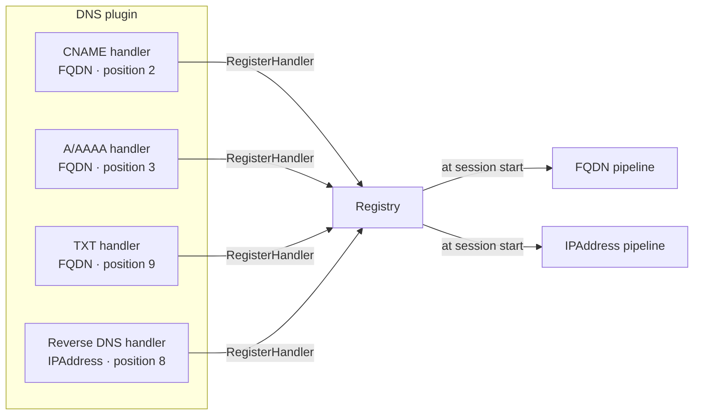

A typical handler does the same few things every time:

1. Read the event's asset (an FQDN, say).
2. Ask the configuration for the transformation's TTL, and check whether the
   asset was monitored within it.
3. Either read the earlier results from the Asset Database or query the source.
4. Store each result as an asset, with the relation that links it, and the
   source and confidence as properties.
5. Dispatch each new in-scope result as an event of its own.

Across the plugins, about 100 handlers are registered, more than 40 of them on
`FQDN` alone. Third-party sources that need an account read their keys from
`datasources.yaml`; see [Data Sources](../configuration/data_sources.md).

---

## :material-robot-outline: Where AI fits

The engine itself uses **no language model**. Its collection is deterministic
and explainable. The AI features sit beside it and on top of it:

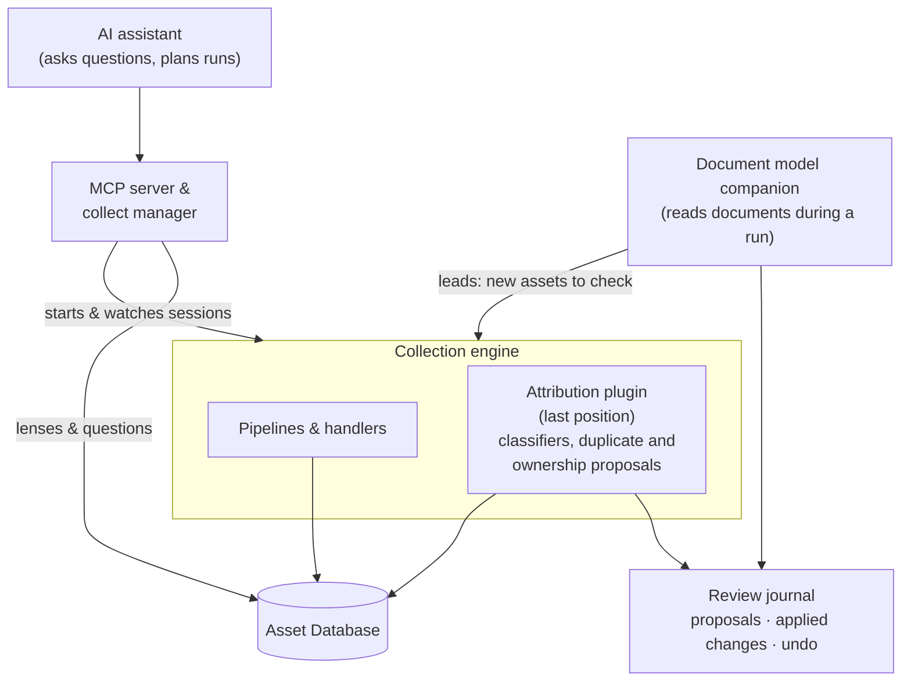

- The **attribution plugin** runs at the end of the pipelines. It compares
  organizations, proposes ownership and merges, and records every decision in
  the review journal, where it can be undone.
- The **document model** reads collected documents during a run and hands the
  engine new assets as **leads**. The engine checks a lead exactly like anything
  else it finds.
- The **MCP server** lets an AI assistant plan an enumeration, start it (with
  your approval), watch it, and answer questions from the Asset Database.

See [AI (Experimental)](../ai/index.md) for details.

---

## :material-book-open-variant: Glossary

| Term | Meaning |
|:--|:--|
| **Asset** | A thing on the attack surface, typed by the Open Asset Model: an FQDN, IP address, certificate, organization, … |
| **Event** | One asset being worked on within a session. |
| **Session** | One enumeration: its configuration, scope, backlog and pipelines. |
| **Pipeline** | The ordered stages of handlers for one asset type. |
| **Handler** | One piece of a plugin that works on one asset type at one position. |
| **Transformation** | An allowed path from one asset type to another through a plugin or source, with a TTL. |
| **Backlog** | A session's durable queue of discovered assets waiting for, or finished with, a pipeline. |
| **Job** | One enumeration of one scope, shared by the engine sessions on a database that work on it. |
| **Worker** | An engine session working on a job; a pool worker joins running jobs on its own. |
| **Dispatcher** | Feeds pipelines from session backlogs, fairly and within limits. |
| **Scope** | What the session is about; only in-scope results are expanded. |
| **TTL** | How long a source's answer about an asset is reused before asking again. |

**Next:** [The Logic Behind the Engine's Design](design.md)
