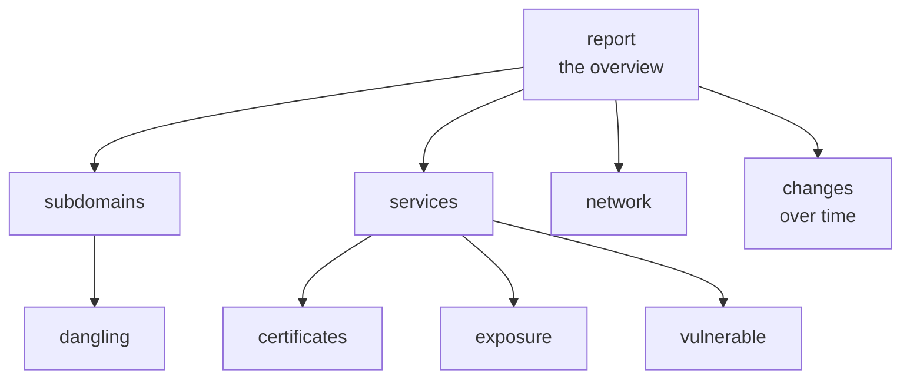

# Map an attack surface

Once a domain is collected, the lenses turn the Asset Database into an
attack-surface picture. This guide walks from a high-level report down to the
specific views you will use most. It assumes you have already run a collection
(see [Your first enumeration](first-enumeration.md)).



## Start with the overview

```bash
amass lens report -d example.com
```

The `report` lens summarizes the footprint: how many names, hosts, services and
networks were found, and where the notable exposure is. Use it to decide which
of the focused lenses below to open next.

## Hosts, services and software

```bash
amass lens subdomains -d example.com    # the names, grouped
amass lens services   -d example.com    # listeners, ports and software
amass lens network    -d example.com    # addresses, netblocks and ASNs
```

`services` identifies the software a response's headers and banners name (for
example `nginx 1.24.0`), flags services on unusual ports, and lists the
certificates each host presented.

## Where you are exposed

```bash
amass lens exposure     -d example.com   # internet-facing surface worth review
amass lens certificates -d example.com   # expiring or weak certificates
amass lens dangling     -d example.com   # dangling records (takeover risk)
```

For known vulnerabilities, refresh the data first, then read the lens:

```bash
amass vuln-update
amass lens vulnerable -d example.com
```

## Concentration and coverage

```bash
amass lens concentration -d example.com  # where the surface clusters
amass lens coverage      -d example.com  # what has not been collected yet
```

`concentration` shows single points of failure or heavy reliance on one
provider; `coverage` tells you where to enumerate next.

## What changed

If you collect the same target over time into a persistent database, the
`changes` lens compares the latest run with the previous one:

```bash
amass lens changes -d example.com
```

New names, services that appeared or went quiet, and certificates that rotated
all show up here — useful for ongoing attack-surface monitoring.

## Visualize it

Any of this can be exported as a graph for a different tool or a report:

```bash
amass viz -d3   -d example.com   # interactive D3 force-graph (HTML)
amass viz -dot  -d example.com   # Graphviz DOT
amass viz -gexf -d example.com   # Gephi GEXF
```

See [Visualizations](../usage/viz.md) for the formats, and
the [Lenses reference](../usage/lenses.md) for every lens and its options.
