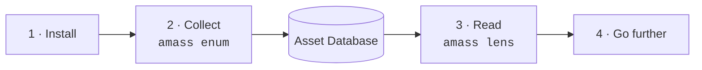

# Your first enumeration

This guide takes you from nothing to a mapped domain: install Amass, run a
collection, and read the results. It assumes no prior setup.



## 1. Install Amass

The quickest way is to build the single `amass` binary with Go:

```bash
CGO_ENABLED=0 go install -v github.com/owasp-amass/amass/v5/cmd/amass@main
```

The binary lands in `$GOPATH/bin` (usually `~/go/bin`); make sure that is on
your `PATH`. Check it runs:

```bash
amass -h
```

!!! tip "Prefer containers?"
    You can also run the whole stack — Amass plus a database and optional
    extras — with [amass-docker-compose](https://github.com/owasp-amass/amass-docker-compose).
    Its README has the setup steps.

## 2. Run a collection

Point `amass enum` at a domain. By default collection is **passive**: it gathers
from data sources and the DNS and contacts no host in the target's own
infrastructure.

```bash
amass enum -d example.com
```

Everything Amass observes is stored in the [Asset Database](../asset_db/index.md).
With no configuration, that is a local SQLite database under the Amass data
directory, so you can read it back with the other subcommands.

!!! warning "Only test what you are allowed to"
    Passive collection is safe to run against any domain. **Active** collection
    (next section) sends traffic to the target — only use it on assets you own
    or are authorized to assess.

## 3. Read the results

The `lens` subcommands are read-only views over what you just collected. Start
with the attack-surface report:

```bash
amass lens report -d example.com
```

Then look at specific facets:

```bash
amass lens subdomains -d example.com    # the names discovered
amass lens services   -d example.com    # what is listening, and the software
amass lens geography  -d example.com    # where it is hosted and registered
```

Every lens takes `-format json` if you want machine-readable output instead of
text.

## 4. Go further

- **Active collection** adds zone-transfer attempts, certificate grabs and
  service probes on in-scope addresses:

    ```bash
    amass enum -active -d example.com
    ```

    See [Enumeration](../usage/enum.md) for scoping with netblocks (`-cidr`) and
    autonomous systems (`-asn`).

- **A persistent database.** Point Amass at PostgreSQL (or Neo4j) so results
  accumulate across runs — see the [Asset Database](../asset_db/index.md) and
  [Configuration](../configuration/index.md) pages. Use the same `-config` for
  every subcommand so they read what your enumeration stored.

- **Keep reading.** [Map an attack surface](attack-surface-report.md) goes deeper
  into the lenses, and [Investigate with AI](investigating-with-ai.md) shows how
  to ask questions of the data.
