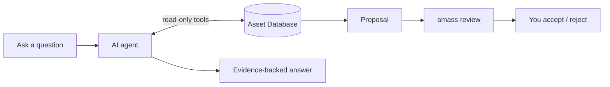

# Investigate with AI

!!! warning "Development preview"
    The AI workflows live on the `feature/ai-investigation-inference` branches
    and are not yet published or production-ready.

Amass can reason over what it has collected: you ask a question in plain
language and get an answer backed by the evidence in the Asset Database, and it
can propose correlations for you to confirm. Collected facts and AI inferences
stay separate, and nothing an AI suggests changes the database until you accept
it. For the concepts, see the [AI overview](../ai/index.md); this guide is the
hands-on path.



## Ask a question

Point `amass ai` at a model and ask. Amass works with any OpenAI-compatible or
Anthropic endpoint, or an approved local model:

```bash
amass ai -config /path/to/config.yaml \
  -provider compatible \
  -model YOUR_MODEL \
  -endpoint https://MODEL_HOST/v1/chat/completions \
  -question "Which organizations share hosting with example.com?" ask
```

The agent uses only a restricted, read-only set of graph tools to gather
evidence before it answers, so its reply is grounded in what was actually
collected — not in the model's general knowledge.

## Explore through an assistant (MCP)

Amass also exposes those read-only graph tools through an MCP server, so an AI
assistant in your own client can explore the database with you — retrieving
assets, walking relationships, reading the evidence behind a fact, and drawing
bounded graphs. The assistant can only read, within fixed limits; it has no raw
query, shell, or arbitrary network access.

## Review what it proposes

Correlations the AI suggests — such as two organizations that may be the same
company, or an affiliation — are written as **proposals**, never applied
automatically. Work through them with the review workflow:

```bash
amass review            # see and act on pending proposals
```

Accepting a proposal records the decision; your decisions are the only thing
that changes trusted data. See [Review](../usage/review.md) for the full
workflow and how to undo a change.

## Good questions to start with

- "What evidence connects these two hosts?"
- "Which networks does this organization's surface concentrate in?"
- "Are any of these organizations the same company?"
- "What changed for this domain since the last enumeration?"

Keep questions anchored to assets you have collected — the agent answers from
the database, so the richer your enumeration, the better the answer.
