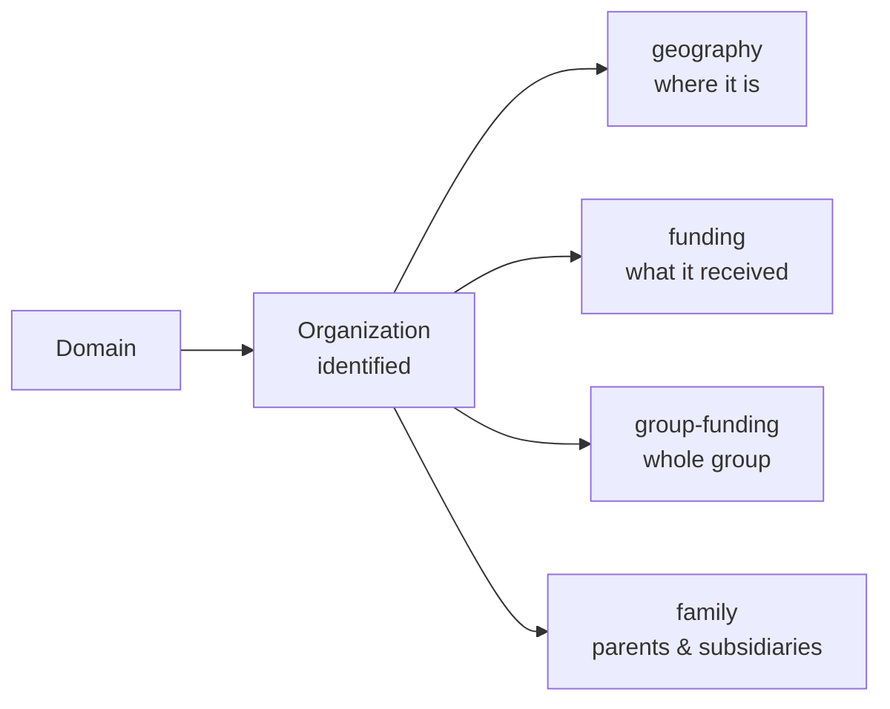

# Organizations and corporate groups

!!! warning "Development preview"
    The organization-identity, geography-inference and funding features
    described here live on the `feature/ai-investigation-inference` branches and
    are not yet published.

Amass builds a profile of the organizations behind the assets it finds — who
owns a domain, where they are, how they are funded, and how they fit into a
corporate group. This guide shows how to use that, end to end.



## The company behind a domain

When you enumerate a domain, Amass tries to identify the company that owns it and
add it as an `Organization`. For a company that runs its own network this comes
from registration records and certificates; for a **cloud-hosted** company —
where those records name the hosting provider — Amass looks the company up from
the domain itself (see [Organizations: identity and geography](../ai/organizations.md)).
No extra flags are needed; it happens during collection.

Find the organization once it has been collected:

```bash
amass lens geography -org "Example Corp"
```

## Where an organization is

The `geography` lens reports an organization's **inferred country** — Amass's
best determination from the evidence (legal jurisdiction, a registration or
contact address, a registrant phone) — alongside the countries of its stored
addresses and of the networks hosting its names:

```bash
amass lens geography -org "Example Corp"
```

## How it is funded

Amass collects public funding — venture rounds, grants, contracts and
procurement awards — and the `funding` lens surfaces it, with the funder behind
each one:

```bash
amass lens funding -org "Example Corp"
```

See [Funding and procurement data](../ai/funding.md) for the sources and how a
transfer is modelled.

## Roll it up across a group

A large institution's funding is often split across records that name different
parts of it — a parent and its subsidiaries, a university system and one of its
campuses. The `group-funding` lens merges the whole group and gives a group
total:

```bash
amass lens group-funding -org "Example Corp"
```

To see the group structure itself — parents, subsidiaries and units, with each
one's jurisdiction and registration number — use the `family` lens:

```bash
amass lens family -org "Example Corp"
```

These group links come from stored control relationships (such as parent/child
registry records), never from a shared name alone.

## Confirming it is the same company

Two records with the same name are often **different** companies in different
jurisdictions. Amass treats a shared registry identifier (an LEI, D-U-N-S, EIN,
and so on) as the strong signal, and surfaces same-company and affiliation
candidates as [review](../usage/review.md) proposals for you to confirm — it does
not merge them on a name match. The [`duplicates`](../usage/lenses.md) and
[`identity`](../usage/lenses.md) lenses show these candidates.
