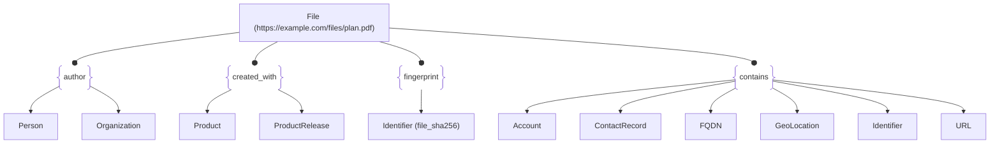

# :simple-owasp: File

The **File** asset type in the [OWASP](https://owasp.org)
[Open Asset Model](https://github.com/owasp-amass/open-asset-model) (OAM)
represents a file that is publicly accessible from the internet—typically
retrieved via HTTP or HTTPS. This includes web-accessible files such as PDF and
Office documents, images, JavaScript libraries, configuration exports, or
exposed archives.

- **Definition:** A `File` asset is identified by the URL it was retrieved
  from, with optional metadata such as its file name, media type and size. It
  serves as an abstraction for discrete, remotely hosted resources.

- **Purpose:** Exposed files often contain valuable signals for OSINT and
  security teams. Public documents reveal who wrote them, the software that
  made them, user directory names, email addresses, host names and even the
  GPS position of embedded photos. Modeling these files as assets, and what
  they contain as linked assets, enables targeted analysis, attribution, and
  monitoring.

- **Design Choice:** The `File` type is intentionally simple—centered on its
  URL. Where it was retrieved is the [`URL`](./url.md) `file` relation (and
  the File's key), not a relation of the File. The same content found at
  several URLs is linked through the `fingerprint` relation to a shared
  [`Identifier`](./identifier.md) holding the content hash. Who made the file,
  the software that made it, and what its content names are relations, so
  each becomes an asset that can be pivoted on.

## :material-file-outline: File Attributes

| Attributes | Type   | Required | Description |
|:----------:|:------:|:--------:|:------------|
| `url`      | string | :material-check-decagram: | Fully qualified URL the file was retrieved from (e.g., `https://example.com/files/plan.pdf`) |
| `name`     | string | :material-checkbox-blank-circle-outline: | File name or basename extracted from the URL |
| `type`     | string | :material-checkbox-blank-circle-outline: | The file's media type (RFC 6838), e.g. `application/pdf` or `image/jpeg` |
| `size`     | number | :material-checkbox-blank-circle-outline: | The file's length in bytes, when known |

## :material-file-outline: File Properties

| Property Type | Property Name | Description |
|:-------------:|:-------------:|:------------|
| [`SimpleProperty`](../properties/simple_property.md) | `last_monitored` | Tracks when a data source was last queried regarding this File |
| [`SourceProperty`](../properties/source_property.md) | Source Plugin Name | Indicates that the specified data source discovered this File |

Amass's document collector also records what a document's metadata states as
[`SimpleProperty`](../properties/simple_property.md) values on the File:

| Property Name | Description |
|:-------------:|:------------|
| `doc_title` | The document's title |
| `doc_author` | The author named in the metadata |
| `doc_last_modified_by` | Who last saved the document |
| `doc_creator_tool` | The application that created the document |
| `doc_producer` | The software that produced the file (e.g., a PDF library) |
| `doc_company` | The company named in the metadata |
| `doc_created` | When the document was created |
| `doc_modified` | When the document was last modified |
| `doc_username` | A username from a home-directory path in the metadata |
| `doc_retrieved_from` | Where the bytes were read: a web archive capture URL, or the File's own URL |
| `doc_image_camera` | The camera of an embedded photo (`<image part>: <make and model>`) |
| `doc_image_software` | The software an embedded photo was edited with |
| `doc_image_taken` | When an embedded photo was taken |
| `doc_image_copyright` | An embedded photo's copyright notice |
| `doc_statement` | A finding the document model read from the document (an asset it names, a relation or a field value), as JSON with its quote, the model and the SHA-256 of the version read; tagged `amass-ai` |

## :material-file-outline: File Outgoing Relations

---

| Relation Type       | Relation Label     | Target Assets    | Description   |
| :-----------------: | :----------------: | :--------------: | :------------ |
| [`SimpleRelation`](../relations/simple_relation.md) | `author` | [`Organization`](./organization.md), [`Person`](./person.md) | Who made the document, as its metadata names them (author, last modified by, company): a stronger claim than being mentioned in it |
| [`SimpleRelation`](../relations/simple_relation.md) | `created_with` | [`Product`](./product.md), [`ProductRelease`](./product_release.md) | The software that produced the document, as its metadata names it |
| [`SimpleRelation`](../relations/simple_relation.md) | `fingerprint` | [`Identifier`](./identifier.md) | The file's content hash as a shared `Identifier` (`id_type` `file_sha256`), so the same document found at several URLs is one hop apart |
| [`SimpleRelation`](../relations/simple_relation.md) | `contains` | [`Account`](./account.md), [`ContactRecord`](./contact_record.md), [`FQDN`](./fqdn.md), `File`, [`GeoLocation`](./geo_location.md), [`Identifier`](./identifier.md), [`IPAddress`](./ip_address.md), [`StreetAddress`](./street_address.md), [`Netblock`](./netblock.md), [`Organization`](./organization.md), [`Person`](./person.md), [`Phone`](./phone.md), [`URL`](./url.md) | What the file's content names or records: accounts its paths show, email addresses, host names, links, addresses, phone numbers, people, and the GPS position of embedded photos. A mention does not confer ownership |
| [`SimpleRelation`](../relations/simple_relation.md) | `discloses` | [`Identifier`](./identifier.md) | A credential or cloud identifier found in what it published: an exposed secret (its kind and a hash, never the value) or an AWS access key ID or account ID |

---

*© 2026 Jeff Foley — Licensed under Apache 2.0.*
