# :simple-owasp: FQDN

The **FQDN** (Fully Qualified Domain Name) asset type in the
[OWASP](https://owasp.org)
[Open Asset Model](https://github.com/owasp-amass/open-asset-model) (OAM)
represents a fully specified domain name that uniquely identifies a resource
within the DNS hierarchy. FQDNs are foundational elements in *open-source
intelligence (OSINT)* and are essential to building a thorough *attack surface
intelligence* profile.

- **Definition:** An `FQDN` asset contains a domain name string (e.g.,
  `www.example.com`). It refers to the complete and unambiguous name of a host
  or service as resolved through DNS.

- **Purpose:** This asset type enables the modeling of DNS-resolvable names as
  distinct entities within an attack surface. `FQDN` assets are critical for
  tracing how external users and systems access internal infrastructure, through
  domain-based references rather than direct IP addresses.

- **Design Choice:** By treating FQDNs as first-class assets, the model supports
  DNS resolution chains (via relations like `BasicDNSRelation`,
  `PrefDNSRelation`, and `SRVDNSRelation`) and links to IP addresses, services,
  or other host-based assets. This allows security teams to analyze exposure,
  misconfigurations, or shadow assets rooted in DNS name usage.

In summary, the `FQDN` asset type provides a precise and structured way to
represent domain-based identifiers in the OAM, serving as a core building block
for understanding how infrastructure is referenced and accessed over the
internet or internal networks.

## :material-dns: FQDN Attributes

| Attributes       | Type      | Required   | Description  |
| :--------------: | :-------: | :--------: | :----------- |
| `name` | string | :material-check-decagram: | Unique fully qualified domain name (e.g. `www.example.com`) |

## :material-dns: FQDN Properties

| Property Type       | Property Name       | Description   |
| :-----------------: | :-----------------: | :------------ |
| [`SimpleProperty`](../properties/simple_property.md) | `last_monitored` | Tracks when a data source was last queried regarding this FQDN |
| [`SourceProperty`](../properties/source_property.md) | Source Plugin Name | Indicates that the specified data source discovered this FQDN |
| [`DNSRecordProperty`](../properties/dns_property.md) | `dns_record` | Represents a DNS record for this FQDN that provides only data |

## :material-dns: FQDN Outgoing Relations

```mermaid
graph TD
fqdn1["FQDN (e.g. owasp.org)"]
fqdn2["FQDN (e.g. vpn.owasp.org)"]
nodeRel@{ shape: braces, label: "node"}
fqdn1 --o nodeRel
nodeRel --> fqdn2

ipaddr["IPAddress"]
basicdns1@{ shape: braces, label: "dns_record"}
basicdns2@{ shape: braces, label: "dns_record"}
fqdn1 --o basicdns1
basicdns1 --> ipaddr
fqdn2 --o basicdns2
basicdns2 --> ipaddr

fqdn3["FQDN (e.g. send.owasp.org)"]
prefdns@{ shape: braces, label: "dns_record"}
fqdn1 --o prefdns
prefdns --> fqdn3

fqdn4["FQDN (e.g. _sip._tcp.owasp.org)"]
srvdns@{ shape: braces, label: "dns_record"}
fqdn4 --o srvdns
srvdns --> fqdn1

service["Service"]
port@{ shape: braces, label: "port"}
fqdn2 --o port
port --> service

domrec["DomainRecord"]
regrel@{ shape: braces, label: "registration"}
fqdn1 --o regrel
regrel --> domrec

org["Organization (e.g. Google LLC)"]
serv2["Service (e.g. Google Workspace)"]
verified@{ shape: braces, label: "verified_for" }
fqdn1 --o verified
verified --> org
verified --> serv2

fqdn5["FQDN (e.g. _spf.example.net)"]
spfnb["Netblock / IPAddress"]
spf@{ shape: braces, label: "spf_authorizes"}
fqdn1 --o spf
spf --> fqdn5
spf --> spfnb

soaid["Identifier (e.g. hostmaster@example.com)"]
soa@{ shape: braces, label: "soa_rname"}
fqdn1 --o soa
soa --> soaid

fqdn6["FQDN (e.g. dmarc.example.net)"]
dmarc@{ shape: braces, label: "dmarc_reports_to"}
fqdn1 --o dmarc
dmarc --> fqdn6

ident["Identifier (e.g. Entra tenant ID)"]
tenant@{ shape: braces, label: "identity_tenant"}
fqdn1 --o tenant
tenant --> ident

fqdn7["FQDN (e.g. owasp-mail.org)"]
federated@{ shape: braces, label: "federated_with"}
fqdn1 --o federated
federated --> fqdn7

fqdn8["FQDN (e.g. owasp.okta.com)"]
idp@{ shape: braces, label: "identity_provider"}
fqdn1 --o idp
idp --> fqdn8

signcert["TLSCertificate (federation signing)"]
signing@{ shape: braces, label: "signing_certificate"}
fqdn8 --o signing
signing --> signcert

bucket["StorageBucket (e.g. s3:owasp-assets)"]
bucketRel@{ shape: braces, label: "bucket"}
fqdn2 --o bucketRel
bucketRel --> bucket
```

---

| Relation Type       | Relation Label     | Target Assets    | Description   |
| :-----------------: | :----------------: | :--------------: | :------------ |
| [`BasicDNSRelation`](../relations/basic_dns_relation.md) | `dns_record` | `FQDN`, [`IPAddress`](./ip_address.md) | Represents most RR types |
| [`PrefDNSRelation`](../relations/pref_dns_relation.md) | `dns_record` | `FQDN` | Utilized for RR types that have a preference attribute |
| [`SRVDNSRelation`](../relations/srv_dns_relation.md) | `dns_record` | `FQDN` | Represents the SRV Resource Record type |
| [`SimpleRelation`](../relations/simple_relation.md) | `node` | `FQDN` | Links a DNS zone apex to nodes within the zone |
| [`PortRelation`](../relations/port_relation.md) | `port` | [`Service`](./service.md) | Represents a port at the FQDN with a responding service |
| [`SimpleRelation`](../relations/simple_relation.md) | `registration` | [`DomainRecord`](./domain_record.md) | Links a root domain to its associated registration data |
| [`SimpleRelation`](../relations/simple_relation.md) | `verified_for` | [`Organization`](./organization.md), [`Service`](./service.md) | Evidence was discovered of a business or technical relationship |
| [`SimpleRelation`](../relations/simple_relation.md) | `spf_authorizes` | `FQDN`, [`Netblock`](./netblock.md), [`IPAddress`](./ip_address.md) | A domain this FQDN's SPF record authorizes to send on its behalf (an `include:` or `redirect=` mechanism), or an address range or address it authorizes (an `ip4:` or `ip6:` mechanism), derived from the published SPF TXT record |
| [`SimpleRelation`](../relations/simple_relation.md) | `soa_rname` | [`Identifier`](./identifier.md) | The zone administrator's mailbox named in the domain's SOA record, as an email address |
| [`SimpleRelation`](../relations/simple_relation.md) | `dmarc_reports_to` | `FQDN` | A domain this FQDN's DMARC record sends its aggregate or forensic reports to (an `rua`/`ruf` address), derived from the published DMARC TXT record |
| [`SimpleRelation`](../relations/simple_relation.md) | `identity_tenant` | [`Identifier`](./identifier.md) | The domain's identity tenant, such as a Microsoft Entra tenant ID or an Okta organization |
| [`SimpleRelation`](../relations/simple_relation.md) | `federated_with` | `FQDN` | A sibling domain that shares the same identity tenant federation trust |
| [`SimpleRelation`](../relations/simple_relation.md) | `identity_provider` | `FQDN` | The host the domain's users sign in at: a federation server or an identity provider's tenant host, read from Microsoft's realm answer or the domain's OpenID Connect discovery document |
| [`SimpleRelation`](../relations/simple_relation.md) | `signing_certificate` | [`TLSCertificate`](./tls_certificate.md) | A certificate this host's SAML or WS-Federation metadata names for signing tokens |
| [`SimpleRelation`](../relations/simple_relation.md) | `bucket` | [`StorageBucket`](./storage_bucket.md) | An object-storage bucket this name resolves to (an Amazon S3, Google Cloud Storage or Azure Blob host) |
| [`SimpleRelation`](../relations/simple_relation.md) | `discloses` | [`Identifier`](./identifier.md) | A credential or cloud identifier found in what it published: an exposed secret (its kind and a hash, never the value) or an AWS access key ID or account ID |

---

*© 2026 Jeff Foley — Licensed under Apache 2.0.*
