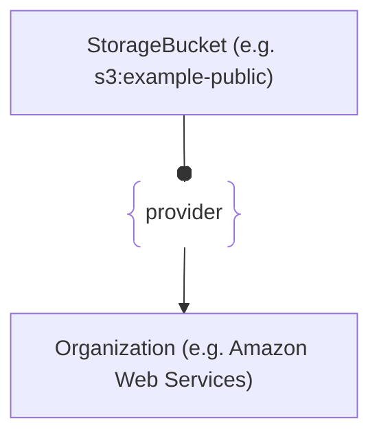

# :simple-owasp: StorageBucket

The **StorageBucket** asset type in the [OWASP](https://owasp.org)
[Open Asset Model](https://github.com/owasp-amass/open-asset-model) (OAM)
represents an object-storage bucket—an Amazon S3, Google Cloud Storage or
Azure Blob container addressed by name within a provider's global namespace,
rather than a service listening on a host port.

- **Definition:** A `StorageBucket` is identified by its service and bucket
  name (e.g., `s3:example-public`), with the provider that operates the
  namespace and the latest observation of whether the bucket exists and is
  world-listable.

- **Purpose:** Buckets hold some of an organization's most sensitive exposed
  data, and a bucket that a DNS name still points to after it was deleted is a
  claimable subdomain-takeover target. Modeling buckets as assets connects the
  names an organization controls to the storage they reach.

- **Design Choice:** The same bucket may be reached through several host names
  (virtual-hosted, website and CNAME endpoints); its identity is the provider
  and bucket name, not any one endpoint. `exists` and `public` hold the latest
  observation, since a bucket can be deleted or made private; a later sighting
  replaces them.

## :material-bucket-outline: StorageBucket Attributes

| Attributes       | Type      | Required   | Description  |
| :--------------: | :-------: | :--------: | :----------- |
| `unique_id` | string | :material-check-decagram: | `"<service>:<bucket>"`, e.g. `s3:example-public` |
| `bucket_name` | string | :material-check-decagram: | The bucket name within the provider namespace |
| `provider` | string | :material-check-decagram: | The cloud provider, e.g. `Amazon Web Services`, `Google Cloud`, `Microsoft Azure` |
| `service` | string | :material-checkbox-blank-circle-outline: | The storage service: `s3`, `gcs` or `azure-blob` |
| `exists` | boolean | :material-check-decagram: | Whether the bucket resolves at the provider; `false` means it is claimable |
| `public` | boolean | :material-check-decagram: | Whether the bucket is world-listable |

## :material-bucket-outline: StorageBucket Properties

| Property Type       | Property Name       | Description   |
| :-----------------: | :-----------------: | :------------ |
| [`SimpleProperty`](../properties/simple_property.md) | `last_monitored` | Tracks when a data source was last queried regarding this StorageBucket |
| [`SourceProperty`](../properties/source_property.md) | Source Plugin Name | Indicates that the specified data source discovered this StorageBucket |

## :material-bucket-outline: StorageBucket Outgoing Relations

---

| Relation Type       | Relation Label     | Target Assets    | Description   |
| :-----------------: | :----------------: | :--------------: | :------------ |
| [`SimpleRelation`](../relations/simple_relation.md) | `provider` | [`Organization`](./organization.md) | The cloud provider that operates the bucket's namespace |

A bucket is reached from the [`FQDN`](./fqdn.md) that resolves to it, through
the `bucket` relation.

---

*© 2026 Jeff Foley — Licensed under Apache 2.0.*
