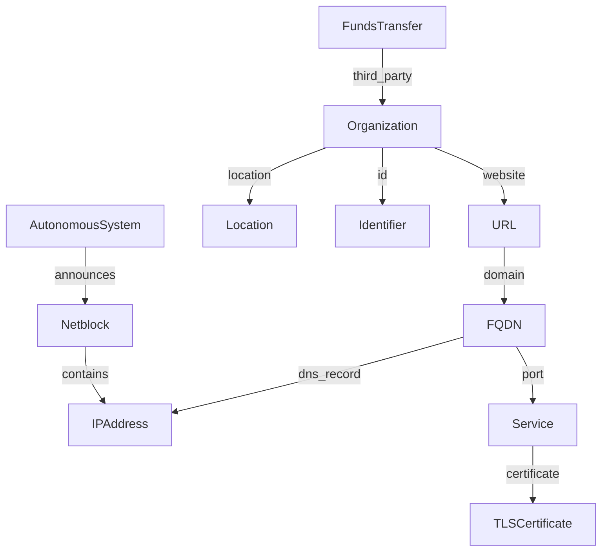

# :simple-owasp: Open Asset Model

The **Amass Project's**
[Open Asset Model](https://github.com/owasp-amass/open-asset-model) redefines
the understanding of an attack surface. Shifting the paradigm away from narrow,
internet infrastructure-focused collection, the **OAM** broadens its scope to
include both physical and digital assets. This approach delivers a realistic
view of **assets and their lesser-known associations**, utilizing adversarial
tactics to gain visibility into potential risks and attack vectors that might
otherwise be overlooked.

---

## **//** Overview

- **Deep Attack Surface Intelligence:** Identifies both **physical and digital
  assets**, moving beyond IT infrastructure.
- **Standardized Asset Framework:** Ensures **consistency in asset
  classification**, facilitating efficient data exchange and streamlined
  analysis.
- **Cyclic Discovery:** Recursively approaches data exploration, leveraging each
  finding to dynamically **expand the target scope**.
- **Community-Driven:** Developed and continuously refined by security experts
  within the **OWASP Amass** ecosystem.
- **Risk Mapping:** Exposes hidden attack vectors by **mapping asset
  relationships** and tracking their changes over time.

---

## :material-vector-polyline: Assets and relationships

The OAM describes an attack surface as **assets** joined by **relationships**.
From any asset you can follow those links outward — a domain to the hosts it
resolves to, a host to its network and services, an organization to the domains
and addresses it controls.

Each asset type, and the relationships and properties that join them, is
documented in this section.

---

## :material-graph: Explore OAM Asset Types

---

-   :material-file-account:{ .lg .middle } **Account**

    ---

    Collect usernames, account types, and related attributes to track exposed
    user accounts

    [:octicons-arrow-right-24: Learn more](assets/account.md)

-   :material-registered-trademark:{ .lg .middle } **DomainRecord**

    ---

    Gather domain insights, including Whois and registrar details

    [:octicons-arrow-right-24: Learn more](assets/domain_record.md)

-   :material-comment-outline:{ .lg .middle } **ContactRecord**

    ---

    Link email addresses, phone numbers, and locations to discovered entities

    [:octicons-arrow-right-24: Learn more](assets/contact_record.md)

-   :material-dns:{ .lg .middle } **FQDN**

    ---

    Record domain resolutions, DNS records, and associated metadata

    [:octicons-arrow-right-24: Learn more](assets/fqdn.md)

-   :material-file-find:{ .lg .middle } **File**

    ---

    Capture file names and hashes to analyze digital artifacts

    [:octicons-arrow-right-24: Learn more](assets/file.md)

-   :material-bank:{ .lg .middle } **FundsTransfer**

    ---

    Identify bank accounts, payment systems, and transaction details

    [:octicons-arrow-right-24: Learn more](assets/funds_transfer.md)

-   :material-id-card:{ .lg .middle } **Identifier**

    ---

    Track unique IDs, references, or numerical values

    [:octicons-arrow-right-24: Learn more](assets/identifier.md)

-   :material-router:{ .lg .middle } **IPAddress**

    ---

    Discover IPs, subnets, and routing structures to uncover key infrastructure

    [:octicons-arrow-right-24: Learn more](assets/ip_address.md)

-   :material-office-building-marker:{ .lg .middle } **Organization**

    ---

    Uncover entity designations, locations, and operational details to expose connections

    [:octicons-arrow-right-24: Learn more](assets/organization.md)

-   :material-account-outline:{ .lg .middle } **Person**

    ---

     Collect names, locations, and attributes to build individual profiles

    [:octicons-arrow-right-24: Learn more](assets/person.md)

-   :material-apps:{ .lg .middle } **Product**

    ---

     Identify online services, cloud providers, and software ecosystems

    [:octicons-arrow-right-24: Learn more](assets/product.md)

-   :material-file-certificate-outline:{ .lg .middle } **TLSCertificate**

    ---

    Gather SSL/TLS certificate details, issuers, and expiration dates for asset
    verification

    [:octicons-arrow-right-24: Learn more](assets/tls_certificate.md)

-   :material-web-refresh:{ .lg .middle } **URL**

    ---

    Log web addresses and associated content to track online presence

    [:octicons-arrow-right-24: Learn more](assets/url.md)

