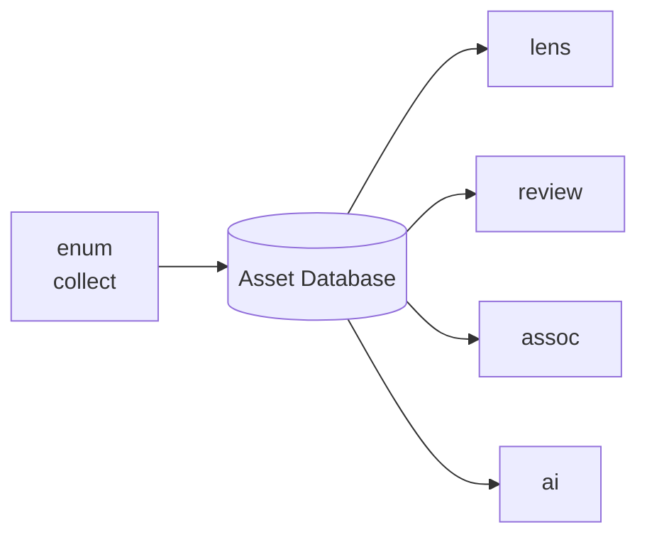

# :material-console: Using the Framework

The `amass` executable is a set of subcommands. Collection fills the
[Asset Database](../asset_db/index.md) with what Amass observes; the other
subcommands read that database and present it. A typical workflow is to
enumerate a target, then read the result through the lenses.

```bash
amass enum -active -d example.com     # collect
amass lens report -d example.com      # read the attack surface
```



## :material-format-list-bulleted: Subcommands

| Command | What it does |
| :--- | :--- |
| [`enum`](enum.md) | Run an enumeration through the engine |
| [`lens`](lenses.md) | Read-only views of the Asset Database |
| [`review`](review.md) | Apply and undo the changes lenses propose |
| [`assoc`](assoc.md) | Walk the database along a path of triples |
| [`vuln-update`](vuln-update.md) | Refresh vulnerability data |
| [`ai`](../ai/index.md) | Plain-language questions, MCP tools, model review |
| [`engine`](../engine/index.md) | Run the collection engine as a service ([how it works](../engine/index.md)) |

Prefix each with `amass` (`amass enum`, `amass lens`, …).

Run any subcommand with `-h` (or `--help`) to see its full flags.

## :material-tune: Common Options

Most subcommands share these:

| Flag | Meaning |
| :--- | :--- |
| `-config <file>` | Path to the YAML configuration file |
| `-dir <path>` | The Amass data directory (local database and output) |
| `-d <domain>` | A root domain, repeatable and comma-separated |
| `-df <file>` | A file of root domain names |
| `-silent` | Suppress output during execution |
| `-nocolor` | Disable colorized output |

The lenses, review and the AI subcommand also take `-format text` (the
default) or `-format json`.

### Where data is read from and written to

Amass reads the database named in the configuration's `options.database`
(PostgreSQL or Neo4j), and otherwise a local SQLite database under the data
directory. The same configuration is used for collection and for reading,
so point every subcommand at the same `-config`/`-dir` to read what an
enumeration stored. See the [Asset Database](../asset_db/index.md) and
[Configuration](../configuration/index.md) pages.

## :material-radar: Passive and active collection

Collection is **passive** by default: Amass gathers from data sources and
the DNS, and contacts no host in the target's own infrastructure.

**Active** collection (`amass enum -active`) adds work that touches the
target directly: zone transfer attempts, certificate name grabs, and
service probes (SSH, the mail and file greetings, HTTP, and JARM) on
in-scope addresses. Active collection paces its probes to each host and
randomizes port order, so a host is not reached by a burst across ports;
see [Enumeration](enum.md#active-collection). Only probe hosts you are
authorized to examine.

## :material-arrow-expand-horizontal: Scope

An enumeration's scope is the domains, IP addresses, CIDRs and ASNs it is
allowed to collect. The scope may **expand** as Amass learns that assets belong
to the target, as far as the configuration's [expansion
policy](../configuration/transformations.md) allows; the `policy-strict.yaml`
example holds the scope to exactly what was given. Active probes run only on
in-scope addresses, so putting an organization's own netblocks or ASNs in scope
lets Amass cover its services.

Amass also reads the routing security records of the netblocks in scope, with
no API key: the routing registry (IRR) route objects that name each netblock's
maintainer, and the RPKI authorizations (ROAs) that say which autonomous
systems may announce it. A netblock whose ROA authorizes the organization's
own AS, or whose route objects are kept by a maintainer that files only the
organization's routes, can join the scope. A maintainer that also files
routes for other networks, such as an upstream ISP or a hosting provider,
only sends its netblocks for review.

Each domain's SOA record names the zone's administrator mailbox. Another
domain whose zone names the same mailbox at one of the organization's own
domains can join the scope; one that shares an outside mailbox, such as a web
agency's, only goes to review. DNS hosts' default mailboxes are ignored. The
address ranges a domain's SPF record allows to send its mail are recorded too,
and go to review, since SPF also lists outside senders such as marketing
services.

Some evidence counts more when it points inside the organization. A domain
served by a name server or mail server in the organization's own domains, or
one that sends all of its mail through the organization, can join the scope.
The same domain sharing an outside server only goes to review. Likewise, the
netblocks announced by the organization's own autonomous system can join the
scope when that AS announces only a few prefixes, as an enterprise or campus
network does; a large network's announcements go to review.

Amass also reads each domain's BIMI record, which brands its mail with a logo.
The record can point to a mark certificate, which a certificate authority
issues only after verifying the organization and, for a registered mark, its
trademark. A mark certificate that lists the domain is stored with the
domain's other certificates, so its verified organization name counts as
certificate evidence. The trademark registration and the organization's Legal
Entity Identifier (LEI) from the certificate are recorded on its subject's
contact record.

Amass reads the software packages an organization publishes on Maven Central and
npm. A Maven group named for one of the organization's domains (`com.example`
for example.com) is one the registry made the publisher prove it controls, so
another domain a package there names as its publisher's site can join the scope.
The other sites packages name, such as homepages and project pages, and every
npm package's links only go to review. Packages are stored as products with
every link they name, including their code repositories. A repository or profile
page on a code host, social network or package registry is treated as the
organization's page, but the site itself (github.com, linkedin.com, npmjs.com)
is never treated as the organization's.

Amass reads each domain's ads.txt and app-ads.txt, where a publisher lists the
advertising accounts allowed to sell its ad space. An account listed as DIRECT
is the publisher's own, so another domain that lists the same DIRECT account can
join the scope. Amass also reads each ad system's sellers.json, which names the
business behind an account: accounts of sales houses are ignored, and a
different business domain listed there only goes to review. So does the owner's
business domain an organization's ads.txt names (OWNERDOMAIN), and another site
whose ads.txt names the organization's domain as its owner's.
