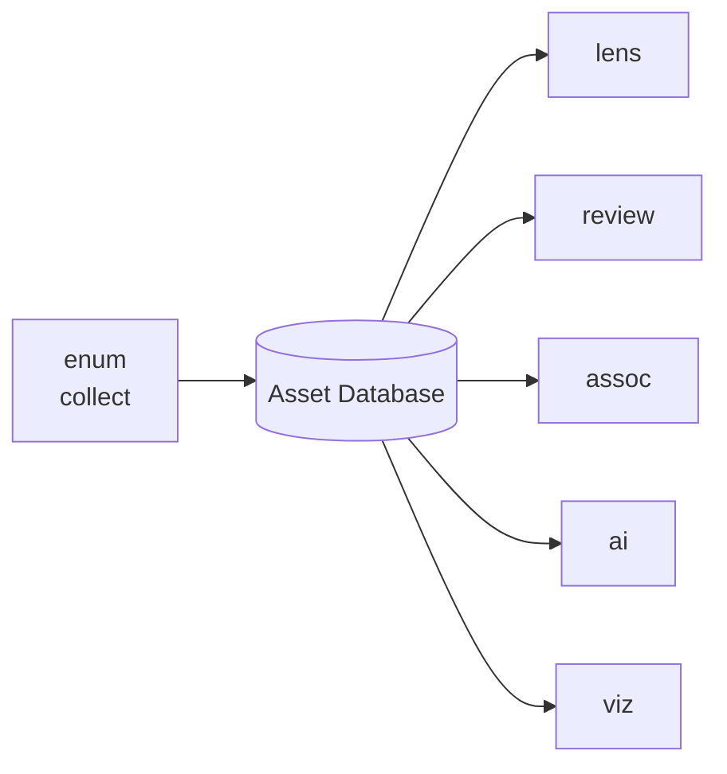

# :material-console: Using the Framework

The `amass` executable is a set of subcommands. Collection fills the
[Asset Database](../asset_db/index.md) with what Amass observes; the other
subcommands read that database and present it. A typical workflow is to
enumerate a target, then read the result through the lenses.

```bash
amass enum -active -d example.com     # collect
amass lens report -d example.com      # read the attack surface
```



## :material-format-list-bulleted: Subcommands

| Command | What it does |
| :--- | :--- |
| [`enum`](enum.md) | Run an enumeration through the engine |
| [`lens`](lenses.md) | Read-only views of the Asset Database |
| [`review`](review.md) | Apply and undo the changes lenses propose |
| [`assoc`](assoc.md) | Walk the database along a path of triples |
| [`viz`](viz.md) | Graph visualizations (D3, DOT, GEXF) |
| [`vuln-update`](vuln-update.md) | Refresh vulnerability data |
| [`ai`](../ai/index.md) | Plain-language questions, MCP tools, model review |
| `engine` | Run the collection engine as a service |

Prefix each with `amass` (`amass enum`, `amass lens`, …).

Run any subcommand with `-h` (or `--help`) to see its full flags.

## :material-tune: Common Options

Most subcommands share these:

| Flag | Meaning |
| :--- | :--- |
| `-config <file>` | Path to the YAML configuration file |
| `-dir <path>` | The Amass data directory (local database and output) |
| `-d <domain>` | A root domain, repeatable and comma-separated |
| `-df <file>` | A file of root domain names |
| `-silent` | Suppress output during execution |
| `-nocolor` | Disable colorized output |

The lenses, review and the AI subcommand also take `-format text` (the
default) or `-format json`.

### Where data is read from and written to

Amass reads the database named in the configuration's `options.database`
(PostgreSQL or Neo4j), and otherwise a local SQLite database under the data
directory. The same configuration is used for collection and for reading,
so point every subcommand at the same `-config`/`-dir` to read what an
enumeration stored. See the [Asset Database](../asset_db/index.md) and
[Configuration](../configuration/index.md) pages.

## :material-radar: Passive and active collection

Collection is **passive** by default: Amass gathers from data sources and
the DNS, and contacts no host in the target's own infrastructure.

**Active** collection (`amass enum -active`) adds work that touches the
target directly: zone transfer attempts, certificate name grabs, and
service probes (SSH, the mail and file greetings, HTTP, and JARM) on
in-scope addresses. Active collection paces its probes to each host and
randomizes port order, so a host is not reached by a burst across ports;
see [Enumeration](enum.md#active-collection). Only probe hosts you are
authorized to examine.

## :material-arrow-expand-horizontal: Scope

An enumeration's scope is the domains, IP addresses, CIDRs and ASNs it is
allowed to collect. By default the scope may **expand** as Amass learns
that assets belong to the target; `-rigid` holds the scope to exactly what
was given. Active probes run only on in-scope addresses, so putting an
organization's own netblocks or ASNs in scope lets Amass cover its
services.
