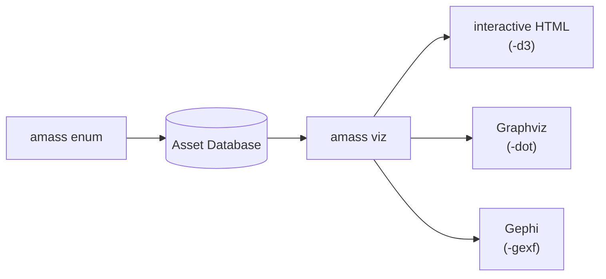

# :material-graph: Visualizations

`amass viz` turns what is stored in the [Asset Database](../asset_db/index.md)
into a graph file you can open in another tool or drop into a report. It does
not collect anything — it reads what earlier enumerations already stored, so
run an [enumeration](enum.md) first.



## Choosing an output format

`amass viz` writes nothing unless you pick at least one format. Each flag
produces one file:

```bash
amass viz -d3   -d owasp.org    # interactive force-directed graph (HTML)
amass viz -dot  -d owasp.org    # Graphviz DOT, for `dot -Tpng`
amass viz -gexf -d owasp.org    # GEXF, for Gephi
```

You can combine them to write several at once:

```bash
amass viz -d3 -dot -gexf -d owasp.org
```

## Options

| Flag | Meaning |
| :--- | :--- |
| `-d3` | Interactive D3 force-simulation HTML — open it in a browser |
| `-dot` | Graphviz DOT, rendered with `dot -Tsvg graph.dot -o graph.svg` |
| `-gexf` | GEXF for Gephi and other network-analysis tools |
| `-d <domain>` | Limit the graph to one registered domain (repeatable) |
| `-df <file>` | Read the domains to include from a file, one per line |
| `-o <dir>` | Directory to write the output files into |
| `-oA <prefix>` | Path prefix for the output file names |
| `-since <when>` | Include only assets validated after a date or time |
| `-config <file>` / `-dir <path>` | Configuration file and data directory |

## Reading the output

- **`-d3`** writes a self-contained HTML file. Open it in a browser: nodes are
  assets (names, addresses, services, organizations) and edges are the
  relationships between them. Drag a node to pull its neighborhood apart, and
  hover to see each asset's type and value.
- **`-dot`** writes a `.dot` file for Graphviz. Render it to an image with, for
  example, `dot -Tsvg owasp_org.dot -o owasp_org.svg`.
- **`-gexf`** writes a `.gexf` file to open in [Gephi](https://gephi.org) for
  layout, clustering and centrality analysis of a large graph.

Use `-since` to visualize only what changed recently — pair it with the
[`changes`](lenses/changes.md) lens to see new infrastructure as a graph.

---

*© 2026 Jeff Foley — Licensed under Apache 2.0.*
